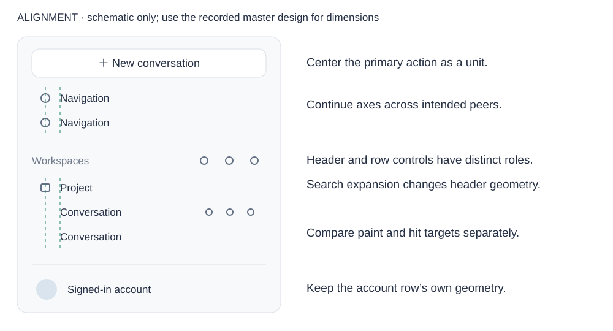
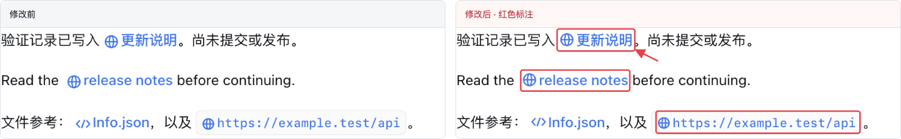
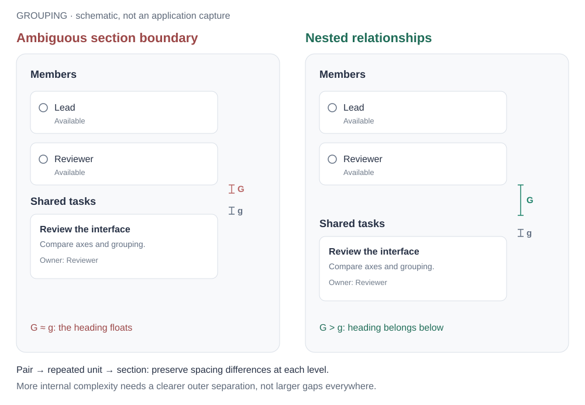
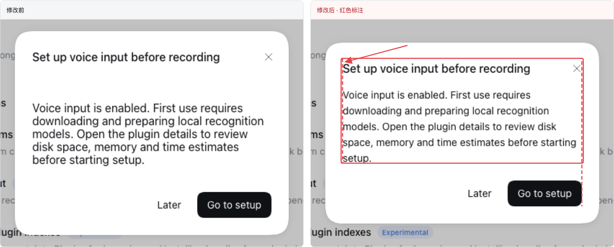

# UI design principles and review cases

English | [中文](ui-design-review-cases.zh.md)

## Summary

Consult the relevant cases when a design relationship is unclear. Ordinary changes inspect affected relationships in page/modal context; they do not require every case, an inventory or a full-page audit. The whole-interface review sections apply when a comprehensive review is explicitly requested. Examples explain transferable principles rather than coverage. See the [review cookbook](cookbook/reviewing-ui-design.md) for optional detailed methods and the owning workflow for effort levels.

## Table of Contents

- [What a review must judge](#judgment)
- [Review the entire page or modal as one unit](#whole-interface-review)
- [Combine the applicable standards first](#review-baseline)
- [Choose cases that expose a design decision](#case-selection)
- [Principle examples](#case-index)
- [1. Alignment](#alignment)
- [2. Spatial grouping](#grouping)
- [3. Whole-page density](#density)
- [4. Information hierarchy](#hierarchy)
- [5. Control states](#states)
- [6. Component choice](#component-choice)
- [7. Icon optics](#icon-optics)
- [8. Control geometry and corner relationships](#geometry)
- [Reproduce and compare](#reproduce)
- [External references and what DSH adopts](#references)
- [Dev Note](#dev-note)

## What a review must judge

A well-composed interface makes relationships visible before the reader studies individual labels. Alignment lets people compare parallel items without repeatedly searching for their starting points. Spacing tells them which icon, label, description, control, and action belong together. These are primary design requirements, including for a fully functional screen; they are not optional polishing after token checks pass.

DSH prioritizes alignment and spatial grouping in visual review. First identify the task and semantic groups, then inspect shared axes across the whole region, then check each group's internal relationships. Follow with hierarchy, state, geometry, color, density, and optical detail. A blocked action or misleading state still takes priority over cosmetic work. Do not make every element equally large, equally spaced, or equally prominent in pursuit of consistency.

The page or modal provides the reference for composition; the [impact scope](cookbook/reviewing-ui-design.md#review-scope) determines which relationships require inspection for a change. Navigation, content, forms and actions may come from different components while sharing text axes and spacing rules. Explain exceptions through role, hierarchy or state; component ownership alone is not a design reason.

The reference diagrams explain relationships; they are not implementation captures or accepted before-and-after results. The examples below explain particular principles and do not establish coverage of the page or modal under review.

## Review the entire page or modal as one unit

Treat the entire page or modal as one visual unit when choosing references and judging relationships. A routine change reviews its affected groups and cross-group relationships in that context; it does not automatically audit every region or the whole product. An explicit whole-interface review must inspect all its regions. A sidebar, form or toolbar remains part of the larger composition even when owned by a separate component.

For a modal, include its title, close control, all content sections, scrolling area and footer actions. For a page, include its navigation, header, toolbars, content and persistent actions. Content below the fold remains part of the same unit. Follow the page or modal's own edges when choosing alignment and centering references; an open modal has its own composition above the underlying page.

### Judge the whole, the groups and the elements

First read the whole composition: content edges, visual center, reading order, primary action and overall density. Then identify groups and subgroups from what they describe or operate on. Compare neighboring groups, followed by the elements within them. Repeated relationships must remain consistent across the entire page or modal, including distant sections.

| Aspect | Compare throughout the page or modal | Basis for judgment |
|---|---|---|
| Alignment | Text starts, icon centers, control edges, repeated action columns | Choose left, center or two-sided alignment by role; continue shared axes across groups; judge an icon and label together |
| Spatial grouping | Label-to-content, item-to-item, group-to-group and section-to-section distances | Internal gaps are smaller than external gaps; more complex groups need greater separation; repeated group structures reuse internal gaps |
| Size and proportion | Same-role controls, icon backgrounds, icons and adjacent text | Use consistent size variants and optical balance; adjusting size can support shared alignment |
| Corner geometry | Containers, cards, fields, buttons and selection controls | Apply one role-based radius system throughout; distinguish inset, flush and independent relationships using the existing radius standard |
| Color and emphasis | Text, associated icons, backgrounds, borders and secondary information | Match the emphasis of an icon and label that communicate together; explain role or state differences |
| Typography and density | Headings, labels, descriptions, repeated rows and overall whitespace | Keep equal-level content consistent and make hierarchy readable; local spacing must fit the whole composition |
| States and behavior | Selected, hovered, focused, disabled, expanded, loading and failed content | State changes preserve recognizable groups, alignment and action access; compare states that appear together |

Consistency means applying the same reasoning throughout this unit. Elements with the same role and size variant follow the same treatment; differences follow from role, hierarchy or state. Being implemented by a different component does not justify a different text start, spacing pattern or radius. Likewise, a centered title and a left-aligned reading column can coexist when their roles support that composition.

### Relate each finding back to the whole

Record which elements conflict, which relationship they should share, and how the correction fits the rest of the page or modal. Compare every occurrence of that relationship within the review scope. After a local adjustment, return to the whole composition and check affected axes, grouping, geometry and hierarchy together.

A full review covers all regions in scope, including relevant scroll positions, expanded content and tabs, and states that change their relationships. Inspect supported widths, themes and input methods where applicable. Preserve drafts, focus, dismissal and primary-action access; show failures with the appropriate recovery. Report uninspected regions and states explicitly. One clean crop, component fixture or selected example cannot establish that the whole page or modal is consistent.

### Use a relationship inventory to establish coverage

List the semantic groups in the assembled interface, then the relationships to compare: parent-child indentation, text columns across sections, repeated action slots, headings and descriptions, fields and validation, prose and inline controls, and scrolling content versus fixed actions. Inspect more than group interiors; every cross-group relationship needs two actually inspected endpoints. When changing a shared primitive, include consumers with and without descriptions, unequal content, and different action combinations.

A relationship passes only when its structure uses one reference, its rendered appearance communicates that relationship, and relevant content or state changes preserve it. An existing assertion, shared token, successful capture, or isolated crop cannot replace these three requirements. Prioritize by misleading effect, frequency, and reach; a difference of only a few pixels does not excuse repeated misalignment.

Record inspected without additional findings, fixed and rechecked, found but unresolved, and uninspected separately. Declare platform and exceptional-state limits where exhaustive coverage is unavailable; example counts, component-test counts, and page-entry counts do not establish that every design passes.

## Combine the applicable standards first

Use the [rule-owner map](../.agents/skills/dsh-client-ui-ux/SKILL.md#select-the-rule-owners) to select current implementation guidance, including alignment, spacing and icons.

A review has two independent obligations: honor the applicable DSH rules and explain whether the assembled result communicates the intended relationships. A convincing silhouette does not excuse the wrong control semantics; legal tokens do not excuse bad alignment. For a scoped review, mark unrelated areas as out of scope. For a whole-interface review, apply the relevant rows below across all regions of the page or modal under review.

| Owner | What it contributes to the review | What to compare across the page or modal |
|---|---|---|
| [Radius standard](ui-radius.md#radius-scale), [nested geometry](ui-radius.md#nested-hover) | Role before size; inset, flush-fill, and independent-child arrangements; curve and documented exceptions | Outer surface, field, hover fill, indicator and clipped edges together |
| [Web styling](web-styling.md#component-rules) | Semantic colors, typography pairs, hairlines, elevation, menu material and motion | Same-role surfaces across features, both themes, native Desktop backdrop |
| [Client UI/UX skill](../.agents/skills/dsh-client-ui-ux/SKILL.md) | Component reuse, hierarchy, loading, feedback ownership and window clearance | Loaded/empty/error scenes and the actual surrounding page |
| [Responsive skill](../.agents/skills/dsh-responsive-ui/SKILL.md) | Space allocation before truncation, input capabilities, focus and primary-action access | Wide, constrained, keyboard and touch use of the same task |
| [Official artwork skill](../.agents/skills/dsh-official-plugin-artwork/SKILL.md) | Package artwork semantics, optical balance, transparent regions and neighboring references | Plugin artwork in list and detail contexts; action icons remain a separate family |
| [Error-handling skill](../.agents/skills/dsh-error-handling/SKILL.md#localized-actionable-visible-reports) | Visible failure, retained valid state and a safe next action | Field correction, failed operation and failed query as distinct situations |
| [Primitives catalog](../packages/client/ui-primitives/README.md#component-catalog) and the relevant package README | Existing variants, focus/interaction behavior and feature-specific requirements | Intended component role versus a visually similar substitute |

The current repository owner and its explicitly recorded exceptions take precedence over an older personal skill or external example. A user choice applies to its named family; it does not silently replace the global system. If implementation disagrees with its stated owner, report that discrepancy instead of treating the existing code as a new rule. Re-read the owner when selecting a radius or material rather than copying a scale into the review.

## Choose cases that expose a design decision

An example makes a principle observable through a task, related elements, surrounding context and a condition that can challenge the correction. Extract the relationship and apply it throughout the page or modal being reviewed. A sidebar or model-editor example does not restrict that principle to those components. Examples are explanatory evidence, not a review menu or coverage list.

Distinguish three kinds of evidence. An actual DSH scene establishes a defect in the displayed conditions. An official design-system example teaches a particular relationship; its dimensions and interaction policy remain that system's. An original diagram explains a proposed relation and must not be labeled an implemented improvement. A fixture only covers its rendered conditions. Keep source, compared objects, applied DSH rule and retest conditions adjacent to the case.

Present each case as scene and problem, design judgment, then its screenshot or paired comparison immediately below. Add a caption naming what to inspect, what each side means, and the source. Do not collect unrelated cases into a detached screenshot wall. If the difference is only faintly visible or the image omits the relationship, choose stronger evidence instead of presenting it as a design exemplar.

## Principle examples

Use these examples to understand a relationship that is unclear. Apply the same principles to every relevant region of the current page or modal, including regions not illustrated here. Review scope comes from the requested interface, not from this example list.

| Case | Relationship to inspect |
|---|---|
| [A1](#case-sidebar-axes) | Role-based sidebar alignment |
| [A2](#case-action-columns) | Distinct header and row action groups |
| [A3](#case-preview-toolbar) | Alignment between rows and compound controls |
| [A4](#case-empty-center) | Centering a content group within its container |
| [A5](#case-composer-controls) | Visible size and center of peer controls |
| [A6](#case-trigger-menu-text) | Text starts across triggers and menus |
| [A7](#case-close-control-edge) | Choosing the close-control edge |
| [G1](#case-title-actions) | Separating content from its action group |
| [G2](#case-team-sections) | Spacing between complex sections |
| [G3](#case-plugin-groups) | Nested groups along the reading order |
| [G4](#case-sidebar-groups) | Separating groups with different purposes |
| [C1](#case-search-color) | Color emphasis within one information unit |
| [S1](#case-sidebar-state) | Persistent selection beside temporary hover |
| [O1](#case-file-optics) | Optical alignment of different icon types |
| [O2](#case-chevron-consumers) | Shared artwork at different consumer sizes |
| [R1](#case-model-radius) | Radii across container and control roles |
| [R2](#case-checkbox-radius) | Small selection controls within a form |
| [R3](#case-automation-radius) | Justified geometry differences between roles |

## 1. Alignment

The [alignment reference](../.agents/skills/dsh-client-ui-ux/references/alignment.md) owns shared axes, complete layout boxes, indentation and text metrics. Use the examples below to apply those decisions.

The schematic distinguishes peer-row axes from account and header geometry; it is not a pixel specification. Compare content, painted backgrounds and hit targets separately; different roles need not share every axis.

### Text metrics and unequal content

An inline icon refers to adjacent text, not the center of the entire paragraph line box. Cap height can calibrate a particular font combination, but is not a universal formula for every font and icon; do not copy one successful offset into every control. A status icon beside multiline guidance usually attaches to the first line, while a single-line button centers its icon and label together. Recheck that relationship after changes to font size, fallback, or language.

The comparison below uses actual Markdown rendering, before on the left and after on the right, with annotations only on the right. CJK, Latin, and code links retain icon dimensions while font metrics correct vertical placement; external and internal gaps separately establish link grouping. Inspect wrapping in the complete paragraph for long links; this crop cannot establish their usability.

Peer cards jointly establish heading starts, description first lines, and action edges. A short description must not independently center vertically because its neighbor is longer; place remaining height after the content group, while bottom actions may align separately. Equal card height does not establish a consistent reading order or require truncating real content to force equal heights.

The comparison below shows actual preset cards with unequal descriptions. On the left, automatic margins detach the short description from its heading; on the right, descriptions start together below their headings and actions remain aligned. The relationship also applies to result cards, choice cards, and parallel summaries; it does not require every page to use cards.

### Example A1: Role-based sidebar alignment

**Scene and relationship.** Compare navigation, workspace rows, conversations and the account area in the expanded sidebar. Include the centered New conversation action and the painted row edges, not only text starts.

**Failure and correction.** Applying one leading-slot width to every role can move titles, enlarge spacing or distort the signed-in account row. Preserve the owning shared variables, compact icon slots and paint insets. Retain deliberate account geometry and hierarchy instead of manufacturing one text axis across all roles.

**Acceptance.** Use guides to compare same-role rows. Check short and long titles, optional icons, project expansion and signed-in/out account states. Revealing row actions must not move the title start. A list crop does not establish whole-sidebar alignment.

### Example A2: Distinct header and row action groups

**Scene and relationship.** Workspace search/filter/add and conversation more/archive/pin occupy the trailing sidebar region but have different roles and spacing. Compare repeated rows with each other; compare the header with its own collapsed and expanded search states.

**Failure and correction.** Choose control sizes, gaps and trailing insets by group role, including during search expansion. Keep the title-to-action separation independent of the gaps inside a cluster.

**Acceptance.** Show the header and row actions together, then expand search and collapse the sidebar. Verify the intended edge relationships, unclipped hit targets and long-title clearance. Do not add empty actions or offsets merely to make unrelated controls form vertical columns.

### Example A3: Alignment between rows and compound controls

**Scene and relationship.** Panel controls sit above file-display controls and an “Open in app” split button. The two rows belong to one preview header, while each row contains operations with different scopes.

**Failure and correction.** Each component may be internally centered while the assembled header has unrelated right insets, heights, and group gaps. Relate the upper icon boxes to the complete lower control, preserving internal icon whitespace rather than aligning extra hit padding or an individual glyph’s painted pixels. Align peer control centers; keep display controls together and separate the external-open action. Treat the split button as one unit. Reducing its outer width can equalize visible gaps while retaining the preceding icon columns; verify both segment targets and the frame’s contribution to layout. Do not force its arrow onto a column intended for an unrelated panel action.

**Acceptance.** Inspect both rows with the path, tabs, and content edge visible. Repeat with a long path and a narrow pane. A row of standalone icons is not a substitute for the actual split control.

### Example A4: Centering a content group within its container

**Scene and relationship.** The automation page has a heading and filters above an illustration, explanation, and create action. The empty-state group belongs in the available content region, with one shared horizontal center and a deliberate vertical position.

**Failure and correction.** Horizontally centering each child while giving the parent fixed top padding leaves the whole group stranded near the top of a tall viewport. Let the content region occupy the remaining height, then position the complete group. Review its internal rhythm too; moving only the button does not center the group.

**Acceptance.** Mark the remaining content rectangle and the bounds of the complete stack. Compare tall, short, and narrow windows with the same content. Distinguish a deliberate, documented optical offset from accidental fixed spacing; do not demand window centering when a sidebar or page toolbar changes the usable area.

### Example A5: Visible size and center of peer controls

**Scene and relationship.** Attachment and send actions anchor the same bottom toolbar. DSH's intended treatment uses equal circular bases and a shared vertical center; their different importance is expressed through fill and state.

**Failure and correction.** Different base diameters plus an extra vertical translation create two unrelated anchors. Normalize the peer controls' outer geometry and remove layout compensation, then balance the plus and arrow within their slots. A thin plus and a solid arrow need not have equal painted area.

**Acceptance.** Compare both bases and centers in empty, enabled, busy/stop, and narrow layouts. Review the toolbar alongside the composer outline, not as two isolated button screenshots. A reference product's unequal controls do not override an explicit DSH requirement for equal bases.

### Example A6: Text starts across triggers and menus

**Scene and relationship.** A permission trigger uses a larger, heavier icon than its menu rows, but their corresponding labels should start on one axis. A search prompt, result heading and option label can share a similar reading edge.

**Correction and acceptance.** Sum each surface’s border, padding, leading slot and gap before adjusting it. Matching only icon sizes or outer card edges leaves different text starts. Check the assembled open menu, longer labels and narrow layouts; distinguish device-pixel rounding of portal coordinates from a whole inset mismatch.

### Example A7: Choosing the close-control edge

**Scene and relationship.** A modal has a close glyph inside a larger button and a footer action at the content edge. An icon-box edge and a button edge imply different header insets.

**Correction and acceptance.** Name the intended edge before changing the shared header. If the full button aligns with the footer action, retain the icon’s internal centering instead of pulling it to that edge. An explicitly icon-aligned composition remains a distinct variant. Check short and wrapping titles, description/body combinations and footer actions, and preserve the target size.

## 2. Spatial grouping

The [spacing reference](../.agents/skills/dsh-client-ui-ux/references/spacing.md) owns semantic groups, internal/external gap relationships and visible whitespace. The cases below explain how to apply it.

G is the separation from the previous section to the new heading; g connects the heading to its content. Repeated member cards retain the same internal arrangement and gap. Its gap markers describe relationships in one construction, not new global spacing tokens. The crucial relation survives when the page becomes denser: keep the hierarchy between levels rather than subtracting the same amount from every gap.

### Example G1: Separating content from its action group

**Scene and relationship.** The title is one group and the three actions are another. Inside the action cluster, the icons are peers. A title-to-action gap smaller than the icon-to-icon gaps visually attaches the title to the first icon while separating that icon from its peers.

**Correction and acceptance.** Reserve the cluster as a unit, use compact regular internal gaps, and leave a distinctly larger title-to-cluster gap. Inspect the visible title ending, not only its flex box. Repeat with a long title, hover, focus, and an open menu; truncation or marquee behavior must not consume the separation.

### Example G2: Spacing between complex sections

**Scene and relationship.** Member cards form a section; the following “Shared tasks” heading belongs to the task cards below it. The transition must be more evident than the separation within either section, especially when the last member row is only partly filled.

**Correction and acceptance.** Treat each heading and its content as one section and give the two sections explicit separation. Compare the last member card → task heading gap with the heading → first task gap, using the actual text and card edges. A 2:1 CSS margin ratio is not a substitute for looking. Check one and several member rows, wrapping task text, and the empty-task variant.

### Example G3: Nested groups along the reading order

**Scene and relationship.** The page heading and introduction form one group; search serves the catalog; a subsection heading and its description introduce that subsection's cards. Reusing the same vertical gap at every transition flattens three levels into one sequence.

**Correction and acceptance.** Keep each heading close to its own explanation, separate page introduction from catalog tools, and keep each subsection closer to its cards than to its neighbor. Repeated subsections reuse this rhythm. Inspect the full stack with a wrapped introduction and expanded cards; do not solve the problem by placing a border around every paragraph.

#### Primer: equal control widths do not fix a broken reading order

The [Forms structure comparison](https://primer.style/product/ui-patterns/forms/#structure) contrasts one vertical sequence with a shorter two-column arrangement. In the latter, a long option-group label wraps while unrelated fields start a second reading path. Inspect the sequence and ownership of groups, not just matching input edges.

| Primer's positive example | Primer's counterexample |
|---|---|
|  |  |

Images: GitHub Primer, linked from their original sources. Compare the two reading paths and the wrapping option-group label. Apply that grouping judgment to forms throughout the page or modal, including long labels and errors. Related values can share a row when the relation is clear and the pair can stack. These are external examples, not DSH implementation results.

#### Carbon: different distances carry different meanings

The [Form specifications](https://www.carbondesignsystem.com/building-blocks/core/components/form/specifications) include an [annotated complete form](https://s3.us-south.cloud-object-storage.appdomain.cloud/cxp-prod-payload-cms/form-style-1.png). Read its title/description, field rows, option group and submit area in order. The example separates the introductory area, repeated fields and final action with different spacing levels while maintaining a common content edge; the annotations make the hierarchy inspectable.

Use that comparison to review DSH's plugin introduction, search, section description and cards, or a model editor's final action. Compare which elements belong together after adding a line of text. Carbon's numerical scale is evidence for its own example, not a new DSH spacing catalog. A DSH result must also satisfy its existing density, font and responsive rules.

Image: IBM Carbon Design System. Follow the annotations between the introduction, repeated fields and final action. The image demonstrates its own spacing system; it does not prescribe DSH pixel values.

### Example G4: Separating groups with different purposes

**Scene and relationship.** “New conversation” is the main action; plugins/automations/more are a global navigation group; the workspace heading introduces the project list. Equal row heights do not express these different relationships.

**Correction and acceptance.** Keep the navigation rows together, separate that group from the workspace section, and bring the workspace heading closer to the projects it labels. The main action has its own separation. Review the full sidebar with the account area visible; compare the role-specific relationships from A1. A larger gap before every project would falsely turn each item into a separate section.

### Composed whitespace and responsive grouping

Identify the layer responsible for group separation, then account for the assembled result: parent gap, child margins, native paragraph margins, heading padding, line-box whitespace, and conditional nodes can accumulate. Compare visible internal and external distances at the same hierarchy level; do not mechanically compare every large internal space against an unrelated outer gap. Initial-content spacing may differ when a heading has a description, but both structures need clear ownership.

Shared containers should provide stable heading, description, body, and action arrangements that consumers reuse. Do not spread negative margins through consumers to cancel container defaults. Express a concrete role or variant when a different distance is needed, then recheck other shared-container combinations; a tighter local arrangement does not imply compressing every dialog.

The comparison below shows an actual voice setup dialog. On the left, body and native paragraph margins accumulate and detach guidance from the heading; on the right, the shared description region keeps heading and guidance together while separating actions. This illustrates judging composed relationships, not adopting this dialog's distances everywhere.

Reflow complete semantic groups first in narrow containers. If an input squeezes its guidance into a very narrow text column, keep label and guidance together and move that field's input below them; do not shrink every font or move guidance into a neighboring group. Verify actual component width and both sides of the breakpoint, not only browser width. Container queries must work in the assembled application; selectors, CSS module names, or ancestor structure can prevent a plausible declaration from applying.

## 3. Whole-page density

Allocate available space to the task's content and controls instead of reducing every gap or font size.

Density concerns how much useful work fits in the available space and how clearly it is organized. Compact repeatable rows can coexist with generous section gaps. Start with the reading and operating task, not an empty-space percentage. A long list benefits from stable row rhythm; a decision form needs its explanations and validation; an empty page needs a coherent central group rather than the same padding as a populated list.

When width decreases, preserve semantic groups before shortening labels or moving actions. Wrap complete groups and keep their internal spacing patterns. When height increases, decide which region should expand; fixed gaps alone do not place an empty state. Inspect both excessive compression and excessive separation. A dense page is acceptable when comparison remains easy; a sparse page can still have poor grouping.

## 4. Information hierarchy

Make the next reading or decision step visible without turning every text element into a heading.

Use emphasis to express a task-relevant difference. A current selection, an actionable error, and the data needed for a decision deserve stable recognition. Labels and supporting metadata can be quieter, but making useful text difficult to read is not hierarchy. Inspect size, weight, color, position, and surrounding whitespace together; piling all five onto every heading removes meaningful contrast.

Use the [icon owner](../.agents/skills/dsh-client-ui-ux/references/icons.md) for icon/label foreground roles and their semantic exceptions; example C1 applies that rule to search fields.

Typography participates in geometry: compare text starts, baselines and line boxes with the intended font, long translations and relevant font preferences. Pair size with line height and use the weight limits from [visual foundation](../.agents/skills/dsh-client-ui-ux/SKILL.md#visual-foundation). Content, code, terminal and fixed interface roles need not scale identically; check the [font-setting owner](../packages/client/ui-theme/README.md) before treating a deliberate difference as a defect. Correct the container allocation before shrinking useful text to force alignment.

### Example C1: Color emphasis within one information unit

**Scene and relationship.** Compare the empty automation search with the expanded sidebar search. Both pair a magnifier with a prompt, but one makes the icon darker and the other makes the text darker.

**Correction and acceptance.** Give the empty-field prompt one foreground role, including the leading icon. Compare computed color, opacity, disabled styling, and the background together; two identical color tokens can still differ after an ancestor fades one child. Test empty, typed, focused, disabled, light, and dark variants. Typed query text and an independently actionable clear button need not use the placeholder's weaker role. A submenu value and its trailing chevron also form one value: a muted model name with a darker chevron fails that relationship even when their geometry is correct.

## 5. Control states

Persistent state and transient feedback must remain distinguishable when they occur together.

State design assigns stable meanings, not just different colors. Selection says “this is the current item”; hover says “the pointer is here”; focus says “keyboard input goes here”; disabled says “this action is unavailable.” Compare simultaneous states and adjacent items: the selected row beside a hovered unselected row matters as much as selected-plus-hover on one row.

| Combination | What must remain legible | Failure to look for |
|---|---|---|
| Selected + another row hovered | Current location remains recognizable | The temporary row looks more selected than the current row |
| Selected + hover on the same item | Selection persists while interaction feedback appears | A generic hover fill erases the current state |
| Selected + keyboard focus | Location and keyboard target remain distinguishable | Focus disappears into the selection treatment |
| Selected + disabled | Retained choice and temporary unavailability both remain visible | Fading the item makes it look deselected |
| Expanded + menu open | The active operation has a clear owner | A panel highlight and row highlight compete without a stable relationship |

### Example S1: Persistent selection beside temporary hover

**Scene and relationship.** Compare the selected conversation, a neighboring hovered row and an open row menu. Background paint is one cue alongside the current-row semantics and revealed actions; selection and hover do not require different colors.

**Correction and acceptance.** Verify that selection persists when hover ends or a menu closes. Move between neighboring rows and traverse by keyboard; inspect focus, action visibility and current-row semantics together. Compare the same theme and platform material; an opaque fixture cannot establish translucent Desktop contrast.

## 6. Component choice

Choose the component from the interaction it represents, then fit its layout to the available space.

Choose the element by what users can do, then make peers visually coherent. Navigation opens a destination, a toggle changes a setting, a checkbox adds an independent choice, and an action button starts an operation. Similar geometry does not make these interchangeable. A card adds a containing group and more space; it is justified when that group needs an independent summary, state, or action, not merely because a row looks plain.

Keep the control's label, visible bounds, focus behavior, and click target consistent with the chosen interaction. If a visual correction changes those semantics, it needs behavior review as well. Geometry and radius are judged separately in [section 8](#geometry); “native control” is neither a guarantee of visual fit nor a reason to discard keyboard and accessibility behavior.

## 7. Icon optics

The [icon reference](../.agents/skills/dsh-client-ui-ux/references/icons.md) owns interface icon roles, slots, color and optical balance. [Official artwork](../.agents/skills/dsh-official-plugin-artwork/SKILL.md) retains its separate role.

### Example O1: Optical alignment of different icon types

**Scene and relationship.** At one tree depth, compare closed/open folders, native file-type icons, generic files, and names without icons. Then compare the same pattern one level deeper.

**Correction and acceptance.** Preserve the depth indent and common text start. Normalize the placement slots, then compare visible centers and perceived weight within them. Do not move the label to compensate for one glyph, or align all depths to one edge. Inspect at normal size and magnification, with selected backgrounds and long names; the magnified view diagnoses the drawing, while normal size determines whether the result balances.

### Example O2: Shared artwork at different consumer sizes

**Scene and relationship.** A chevron appears beside a menu label and inside a larger floating button. Enlarging its drawing within the same view box changes both appearances.

**Correction and acceptance.** Compare the directional family, both weights and actual consumer sizes. Keep a modest supporting glyph beside text; reduce the floating control’s icon size if needed without shrinking its button. A large glyph sheet alone does not establish balance in either composition.

## 8. Control geometry and corner relationships

Consistency means that equal roles and size variants follow one rule, and different roles have an understandable relationship. Review outer height, width, radius, curve, inset, and visible base together. Legal tokens can produce an incoherent combination; one radius on every element can be equally incoherent. The [radius standard](ui-radius.md) owns values and nested geometry, so this section does not create another scale.

Distinguish a tightly inset surface that follows its container from an independent card inside a panel. The first needs coordinated outer/inner curves and inset; the second follows its own component role. Check the background, border, highlight, pseudo-elements, and clipping together. A hover fill that changes the visible silhouette is a state defect even if the resting border is correct.

### Decide geometry in this order

Classify the semantic role, select its existing size variant, identify the parent/child relationship, then inspect curve, material and state. The [radius scale](ui-radius.md#radius-scale) and its named exceptions supply values; a larger bounding box after expansion does not select a new tier. Equal radius numbers can still look different when height or curve differs.

| Relationship | Decision from the radius owner | Visual failure to look for |
|---|---|---|
| Circular concentric inset | Inner radius is outer radius minus inset, clamped at zero; arcs share a center | Same-radius inner/outer corners pinch or widen the visible band |
| Nested superellipses | Use the shared nominal size relation, then inspect diagonal spacing; they are not exact offset curves | Claiming mathematically equal spacing from subtraction alone |
| Flush fill or adjoining segments | The enclosing silhouette owns exposed corners; internal joins stay square | Notches, crescents, double contours or focus clipped with the fill |
| Independent child card/group | Choose its role tier instead of subtracting all surrounding space | Collapsing a legitimate child radius to zero from large parent padding |
| Explicit circle or pill | Preserve round arcs for the container and its painted contents | A rounded avatar container holding a noncircular image; squircle-like capsule ends |

Compare fill, stroke, hover overlay, focus and clipping together throughout the page or modal. Flat card borders and elevated materials have different paint ownership under [Web styling](web-styling.md#component-rules); applying both can double the edge. When a contour clips its fill, keep popups and keyboard focus fully visible. Inspect the geometry and continued use together.

#### Fluent: the split-button notch is a relationship error

The [Shapes example](https://fluent2.microsoft.design/shapes/#when-to-avoid-rounded-corners) marks the gap where two separately rounded button halves meet. Inspect the internal seam rather than the outer corners: treating each half as a complete independent silhouette breaks the shared enclosure. This is a concrete negative example, not a recommendation to make every control rounder.

Image: Microsoft Fluent 2, linked from its original source. In DSH, apply the flush-fill arrangement from the radius standard, then check independent hover regions, focus and the fully visible popup together. Fluent's radius and stroke scale are not DSH defaults. Look at the notch at the internal seam; this source image is a negative example, not a DSH before/after comparison.

### Example R1: Radii across container and control roles

**Scene and relationship.** A model editor contains grouped model rows, two inputs per row, an “Add model” button, and cancel/save actions. Every corner appears on the same screen, so role and size relationships must be readable together.

**Correction and acceptance.** Classify the outer editor, model group, field, and button before selecting their existing variants. Same-role controls at the same size match. Coordinate tightly nested curves with actual inset, while independent children retain their own role. Check collapsed/expanded rows, field focus, hover fills, and long model names. Do not justify a random radius by pointing to the total height after expansion.

### Example R2: Small selection controls within a form

**Scene and relationship.** Input-type choices use dark native checkboxes beside rounded form controls. The mismatch concerns the small control's silhouette and visual weight, not a requirement to give a checkbox the radius of a large input.

**Correction and acceptance.** Use a coherent small-selection-control treatment while preserving the recognizable checkbox silhouette and label association. If native appearance is replaced, retain checked/unchecked, disabled, keyboard focus, and assistive semantics. Compare these states at actual size in both themes; an unchecked outline and its checked fill must belong to the same control family.

### Example R3: Justified geometry differences between roles

**Scene and relationship.** Nearby automation controls combine rounded filter chips, a search field, and a primary create action. Similar control heights can still produce a conspicuous jump in roundness when each feature chooses its own radius.

**Correction and acceptance.** Reuse the established control variants. A true pill is an explicit component type; it does not authorize every compact button to use half its height as radius. Compare filters, search, and primary/secondary buttons in one frame. Check hover and focus contours too. Keep a meaningful pill/field distinction where intended rather than forcing equal radii solely because the controls share a row.

## Reproduce and compare

Locally maintained production-component fixtures can supply isolated examples for repeatable content and state. Derive actual application captures from the whole page or modal under review, including its relevant regions and states. A fixture establishes only what it renders; it does not determine or complete the review scope.

The dimensions found in these components are evidence about those examples, not universal design constants. The [style reference](web-styling.md), [radius standard](ui-radius.md), and component owners retain authority over shared values. Extend the evidence for new consumers or a different task rather than copying an example's number without its conditions.

## External references and what DSH adopts

These are research inputs, not automatically invoked skills or replacements for DSH rules. The selection below was read on 2026-10-26. Public guidance supplies comparison methods; the worked DSH cases and explanatory diagrams are local synthesis. Links point to the original authors. No external skill installation or execution is required to use this reference.

| Reference | Useful contribution | Scope and deliberate limit |
|---|---|---|
| [Anthropic frontend-design](https://github.com/anthropics/skills/blob/main/skills/frontend-design/SKILL.md) | Explicit composition, content-specific choices, and rendered self-critique | Its expressive visual direction is not a mandate to restyle a workbench or change DSH typography |
| [Vercel web-design-guidelines skill](https://github.com/vercel-labs/agent-skills/blob/main/skills/web-design-guidelines/SKILL.md) and [rules](https://github.com/vercel-labs/web-interface-guidelines/blob/main/command.md) | Locate findings in code and cover focus, labels, long content, and interaction | Code compliance alone does not establish alignment or grouping; its title-case advice does not override DSH sentence case |
| [Impeccable](https://github.com/pbakaus/impeccable/blob/main/.agents/skills/impeccable/SKILL.md), [critique](https://github.com/pbakaus/impeccable/blob/main/.agents/skills/impeccable/reference/critique.md), [polish](https://github.com/pbakaus/impeccable/blob/main/.agents/skills/impeccable/reference/polish.md), [operate](https://github.com/pbakaus/impeccable/blob/main/.agents/skills/impeccable/reference/operate.md) | Separate a task-oriented interface from promotional design; distinguish visual judgment from detector output | Adopt the complete-path inspection and existing-system comparison, not its execution, delegation, or scoring machinery |
| [Interface Design](https://github.com/Dammyjay93/interface-design/blob/main/.claude/skills/interface-design/SKILL.md) | Explicit product intent, repeated patterns, and comparison with established neighboring interfaces | Preserve DSH's existing system; do not import its example font weights, create another token catalog, or chase novelty for its own sake |
| [OpenAI figma-implement-design](https://github.com/openai/skills/blob/main/skills/.curated/figma-implement-design/SKILL.md) | Compare rendered output against an actual visual reference and integrate existing components | A screenshot is evidence with a defined scope, not permission to infer unseen states or adopt every number |
| [Fluent Shapes](https://fluent2.microsoft.design/shapes/) and [Primer Forms](https://primer.style/product/ui-patterns/forms/) | Explicit component counterexamples with inspectable relationships | The case analyses above transfer a decision method, not their token or interaction system |
| [Atlassian spacing](https://atlassian.design/foundations/spacing/) | Positive/negative examples of proximity, repeated rhythm, hierarchy, and optical adjustment | Borrow the relationship tests, not Atlassian's token names or an automatic pixel formula |
| [Carbon spacing](https://www.carbondesignsystem.com/building-blocks/foundations/spacing/overview) | Spacing patterns express equal weight and section boundaries; fluid centering differs from fixed spacing | Use DSH's spacing ownership; a scale alone cannot select the right group relationship |
| [Codex official product introduction](https://openai.com/index/introducing-the-codex-app/) and [desktop documentation](https://learn.chatgpt.com/docs/app) | Task-oriented composition and real public examples to compare | Public examples are versioned observations, not the current local app or an unpublished Codex design specification |

### Codex: a limited reference for composition

The official [welcome/composer poster](https://learn.chatgpt.com/images/codex/video-posters/proactive-teammate-v2.webp) and [long-input poster](https://learn.chatgpt.com/images/codex/video-posters/draft-prds-from-slack-linear-docs.webp) show centered introductory content, left-aligned input text, and separate bottom control groups. They support that composition comparison. They do not reveal full-sidebar alignment, nested-corner behavior, neighboring selected/hovered states, or resizing. Use the more specific examples above for those decisions rather than treating a product poster as broad design approval.

External images remain at their credited sources. If a source image is unavailable, the adjacent analysis still identifies the comparison; obtain a usable reference before using that image as visual evidence in a new review.

## Dev Note

None.
