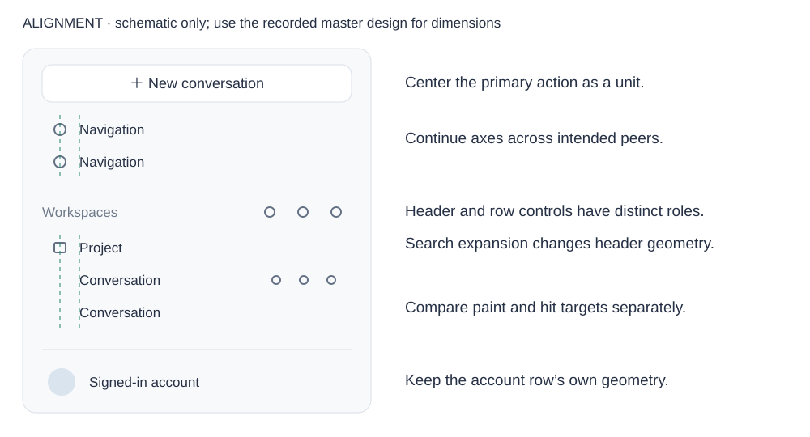
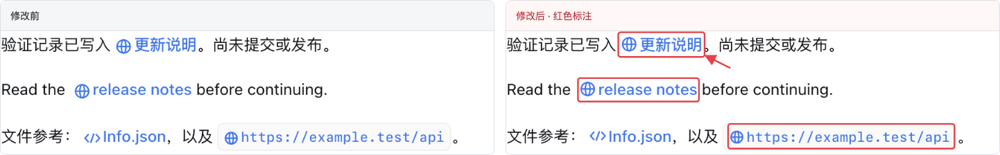
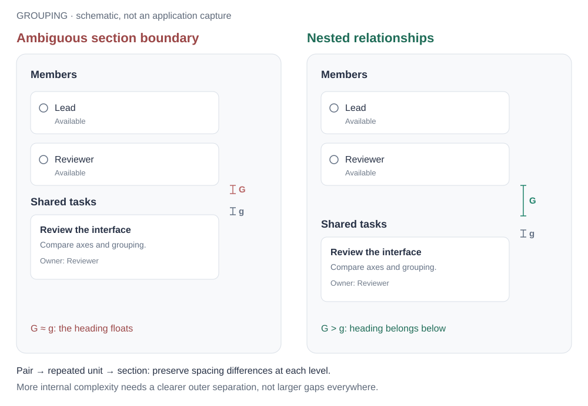
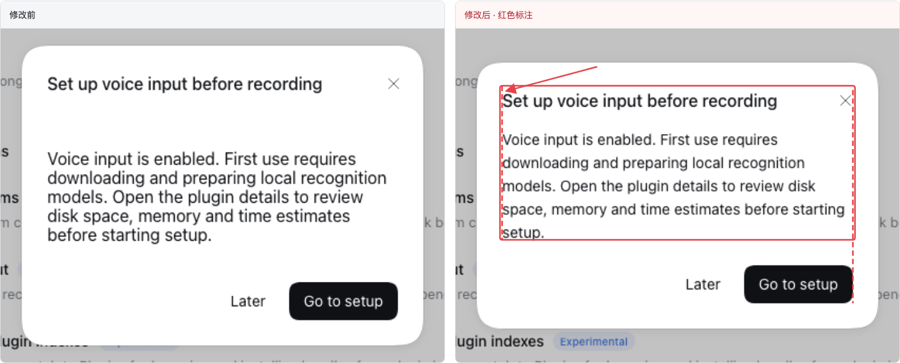

# UI 设计原则与审查案例

[English](ui-design-review-cases.md) | 中文

## 概览

设计关系不明确时查阅相关案例。普通修改以页面／弹窗为上下文检查受影响关系，不要求遍历全部案例、建立清单或完整审查整页。下文整界面审查章节用于明确要求的完整审查。案例解释可迁移的原则，不定义覆盖范围。详细方法按需查阅[审查手册](cookbook/reviewing-ui-design.zh.md)，执行深度以所属流程为准。

## 目录

- [审查究竟要判断什么](#judgment)
- [以整页或整个弹窗作为审查单位](#whole-interface-review)
- [先综合适用规范](#review-baseline)
- [如何用例子理解原则](#case-selection)
- [原则示例索引](#case-index)
- [1. 对齐](#alignment)
- [2. 空间分组](#grouping)
- [3. 整屏密度](#density)
- [4. 信息层级](#hierarchy)
- [5. 控件状态](#states)
- [6. 组件选型](#component-choice)
- [7. 图标光学](#icon-optics)
- [8. 控件几何与圆角关系](#geometry)
- [复现与比较](#reproduce)
- [外部参考与 DSH 的取舍](#references)
- [开发备注](#dev-note)

## 审查究竟要判断什么

好的界面会在读者逐字阅读前先表达元素之间的关系。对齐让人比较并列内容时不用反复寻找起点；间距告诉人哪些图标、标签、说明、控件和操作属于同一组。这些是基础设计要求，即使功能完全可用也要满足，不能等 token 检查通过后才当作可选打磨。

DSH 的视觉审查优先关注对齐与空间分组。先识别任务和语义组，再检查整个区域的跨组对齐轴，然后检查每组内部关系；随后检查信息层级、状态、几何、颜色、密度和光学细节。操作阻塞或误导性状态仍先于纯外观问题。不能为了统一而让所有元素一样大、一样疏密、一样突出。

页面或弹窗提供构图参照；一次改动需要检查哪些关系，由[影响范围](cookbook/reviewing-ui-design.zh.md#review-scope)决定。导航、内容、表单和操作即使由不同组件实现，也可能共用文字轴和间距规则。例外应由角色、层级或状态解释，组件归属本身不是设计理由。

本文原理图解释元素关系，不是实现截图或已验收的修改前后对照。下文例子用于讲清具体原则，不代表已覆盖当前要审查的页面或弹窗。

## 以整页或整个弹窗作为审查单位

选择参照和判断关系时，将整个页面或弹窗视为一个视觉整体。日常改动在这个上下文中审查受影响的分组和跨组关系，不自动检查每个区域或整个产品。明确的完整界面审查必须检查其全部区域。侧栏、表单、工具栏即使由独立组件实现，也属于更大的整体构图。

对弹窗，标题、关闭按钮、全部内容分区、滚动区域和底部操作一起纳入判断；对页面，导航、页头、工具栏、内容区和固定操作一起纳入判断。滚动后才能看到的内容仍属于同一个整体。选择对齐和居中参照时，依据页面或弹窗自己的边缘；打开的弹窗在底层页面之上形成自己的构图。

### 从整体、组间关系看到组内元素

先看整体构图：内容边缘、视觉中心、阅读顺序、主操作和总体疏密。再按内容描述什么、操作什么，判断哪些元素组成一组、组内有哪些子组。先比较相邻组，再看组内元素。同一种关系应在整页或整个弹窗内保持一致，包括相距较远的分区。

| 审查方面 | 在整页或整个弹窗内统一比较 | 判断依据 |
|---|---|---|
| 对齐 | 文字起点、图标中心、控件边缘、重复的操作列 | 按角色选择居左、居中或两侧对齐；共用轴线跨组延续；图标与文字先作为一个单元判断 |
| 空间分组 | 标签到内容、元素之间、组之间、分区之间的距离 | 组内间距小于组间间距；组越复杂，组间距应越大；相似构成的组复用相同组内间距 |
| 尺寸与比例 | 同角色控件、图标底板、图标及相邻文字 | 使用一致的尺寸变体和视觉重量；必要时通过调整大小实现共同对齐 |
| 圆角与轮廓 | 外层容器、卡片、字段、按钮和选择控件 | 全部遵循同一套按角色划分的圆角规则；依据已有规范区分内缩、贴边和独立容器关系 |
| 颜色与强调 | 文字、关联图标、底色、描边和辅助信息 | 共同表达同一信息的图标与文字保持一致的强调；差异应能由角色或状态解释 |
| 字体与疏密 | 标题、标签、说明、重复行和整体留白 | 同层级内容保持一致，层级清楚；局部间距与整体疏密协调 |
| 状态与行为 | 选中、悬停、焦点、禁用、展开、加载和失败内容 | 状态变化后仍能认出分组、对齐关系和操作入口；同时出现的状态放在一起比较 |

统一看待，意味着在这个范围内使用同一套判断依据。同角色、同尺寸变体使用一致处理，差异来自角色、层级或状态。“由不同组件实现”不能解释文字起点、间距模式或圆角为什么不一致。同样，居中的标题与居左的阅读列可以共存，前提是各自角色支持这种构图。

### 把每个发现放回整体判断

记录哪些元素发生冲突、它们应共享什么关系，以及改法如何与页面或弹窗的其他部分协调。在本次范围内比较这种关系的所有出现位置。局部调整后，回到整体构图，一起复查受到影响的对齐、分组、几何和层级。

完整审查覆盖范围内所有区域，包括相关滚动位置、展开内容、标签页，以及会改变这些关系的状态。按适用情况检查支持的宽度、主题和输入方式。保留草稿、焦点、关闭方式和主操作可达性，失败时提供相应恢复。没有检查的区域和状态明确列出。一张合格裁图、一个组件 fixture 或几个选定例子，都不能证明整页或整个弹窗已经协调一致。

### 用关系清单判断覆盖是否完整

把完整界面中的语义组列出来，再列出需要比较的关系：父子缩进、跨分区文字列、重复操作槽、标题与说明、字段与校验、正文与行内控件、滚动内容与固定操作。不只检查每组内部；每条跨组关系都必须连接到实际比较过的两端。修改共用原语时，补查它在有／无说明、长短内容和不同操作组合中的使用方。

关系通过至少满足三项：结构使用同一个参照；实际画面表达该关系；改变相关内容或状态后仍成立。测试断言存在、同一个 token、截图成功或单张裁图都不能单独替代这三项。优先级按误导程度、使用频率及传播范围决定，不能用“只差几像素”排除高频错列。

“已检查无新增问题”“已修复并复查”“发现但未修复”“未检查”分别记录。若无法穷尽平台或异常状态，交付明确的覆盖边界；不能将例子数量、组件测试数量或页面入口数量当成全部设计通过。

## 先综合适用规范

用[规则归属表](../.agents/skills/dsh-client-ui-ux/SKILL.md#select-the-rule-owners)选择当前实现要求，包括对齐、间距和图标专项。

审查有两个独立要求：符合适用的 DSH 规则，同时解释组装后的界面是否清楚表达预期关系。轮廓好看不能抵消交互语义错误，token 合法也不能抵消对齐错误。局部审查应明确不涉及哪些方面；整体审查则在受审整页或整个弹窗的所有区域中检查下表相关项。

| 规则所有方 | 对审查的贡献 | 在整页或整个弹窗中比较什么 |
|---|---|---|
| [圆角规范](ui-radius.zh.md#radius-scale)、[嵌套几何](ui-radius.zh.md#nested-hover) | 先角色后尺寸；内缩、贴边填色、独立子容器三种关系；曲线与明确例外 | 外层容器、字段、hover 填色、指示块及裁切边缘一起比较 |
| [Web 样式](web-styling.zh.md#component-rules) | 语义色、字号与行高配对、发丝线、层级阴影、菜单材质、动效 | 跨功能的同角色表面、明暗主题与 Desktop 原生背景 |
| [客户端 UI/UX skill](../.agents/skills/dsh-client-ui-ux/SKILL.md) | 组件复用、层级、加载、反馈归属、窗口避让 | 加载后／空／错误状态及实际周边页面 |
| [响应式 skill](../.agents/skills/dsh-responsive-ui/SKILL.md) | 先分配空间再截断、输入能力、焦点、主操作可达性 | 同一任务的宽屏、受限宽度、键盘及触屏使用 |
| [官方图案 skill](../.agents/skills/dsh-official-plugin-artwork/SKILL.md) | 插件图案语义、光学平衡、透明区域及邻近参照 | 插件图案在列表与详情中的呈现；操作图标属于另一类 |
| [错误处理 skill](../.agents/skills/dsh-error-handling/SKILL.md#localized-actionable-visible-reports) | 失败可见、保留有效状态、提供安全下一步 | 区分字段纠错、操作失败与查询失败 |
| [基础组件目录](../packages/client/ui-primitives/README.zh.md#component-catalog)与相关包 README | 已有变体、焦点与交互行为、功能特有要求 | 实际组件角色与外观相似的替代品是否相符 |

当前仓库所有方及其明确记录的例外，优先于旧版个人 skill 或外部案例。用户的具体选择适用于指定组件族，不会默默替换全局体系。实现与所属规范不一致时，报告差异，不能把既有代码自动当成新规则。选圆角和材质时重新核对所有方，不在 review 文档里复制另一套尺度。

## 如何用例子理解原则

例子通过具体任务、相关元素、周边上下文，以及可能推翻改法的变化条件，让原则变得可观察。应提炼其中的关系，并用于当前整页或整个弹窗的判断。侧栏或模型编辑器的例子，不会把原则限定在这些组件上。例子是帮助理解的证据，不是审查菜单或覆盖清单。

区分三种证据：DSH 实际场景可以确认所展示条件下的缺陷；官方设计系统案例解释特定关系，其尺寸与交互策略仍属于原系统；原创示意图解释拟采用的关系，不能标成已实现的改善。fixture 仅覆盖它渲染的条件。来源、比较对象、适用的 DSH 规则和复查条件应当紧邻案例。

每个案例按“场景与问题 → 设计判断 → 紧接下方的截图或成对对照”呈现。图注说明看哪里、两侧分别表示什么及来源。不要把无关案例集中成脱离正文的截图墙。差异只有勉强可辨、或图片没有包含所讨论关系时，应选择更有解释力的证据，不能将其当作设计范例。

## 原则示例索引

对某种关系不确定时，可借助这些例子理解。在当前页面或弹窗内，所有相关区域都适用相同原则，包括这里没有举到的区域。审查范围来自用户要求的界面，不由这份示例清单决定。

| 案例 | 要检查的关系 |
|---|---|
| [A1](#case-sidebar-axes) | 按角色判断侧栏对齐 |
| [A2](#case-action-columns) | 重复操作组的对应列 |
| [A3](#case-preview-toolbar) | 多排控件与复合控件的对齐 |
| [A4](#case-empty-center) | 内容组相对所属容器居中 |
| [A5](#case-composer-controls) | 并列控件的可见尺寸与中心 |
| [A6](#case-trigger-menu-text) | 入口与菜单之间的文本起点 |
| [A7](#case-close-control-edge) | 明确关闭控件的对齐边缘 |
| [G1](#case-title-actions) | 内容与操作组的分隔 |
| [G2](#case-team-sections) | 复杂分区之间的间距 |
| [G3](#case-plugin-groups) | 阅读顺序中的多层分组 |
| [G4](#case-sidebar-groups) | 不同用途的组之间的分隔 |
| [C1](#case-search-color) | 同一信息单元的图文强调 |
| [S1](#case-sidebar-state) | 持续选中与临时悬停共存 |
| [O1](#case-file-optics) | 不同类型图标的光学对齐 |
| [O2](#case-chevron-consumers) | 共享图形在不同使用尺寸下的表现 |
| [R1](#case-model-radius) | 不同层级容器与控件的圆角 |
| [R2](#case-checkbox-radius) | 表单中小型选择控件的轮廓 |
| [R3](#case-automation-radius) | 不同角色之间有依据的几何差异 |

## 1. 对齐

[对齐参考](../.agents/skills/dsh-client-ui-ux/references/alignment.md)负责共享轴线、完整布局框、层级缩进和文字度量；以下案例用于说明这些判断。

示意图区分同类行的轴线与账号、标题区域的几何关系，不是像素规范。分别比较内容、背景绘制区域和点击区域；不同角色不必共用所有轴线。

### 文字度量与不等长内容

行内图标的参照是相邻文字，不是整段的行框中心。`cap-height` 可以用于具体字体组合的校准，但不是所有字体与图标的统一公式；不能把某次有效的位移复制到所有控件。多行说明旁的状态图标通常附着首行，而单行按钮的 icon 与 label 作为整体居中。改变字号、字体回退或语言后重新检查这种关系。

下图使用真实 Markdown 渲染，左前右后，标注只在右图。中文、英文和代码链接保持原图标尺寸，通过字体度量修正垂直位置；外部留白与组内留白分别负责链接归属。检查长链接时还需看完整段落中的换行，裁图不能证明长链接可用。

并列卡片应共同确定标题起点、说明首行和操作区边缘。短说明不因相邻说明更长就独自垂直居中；剩余高度放在内容组之后，底部操作可以另行对齐。统一卡片高度不等于统一内部阅读顺序，也不要求裁短真实内容来制造等高。

下图为实际预设卡片的长短内容组合。左侧短说明因自动外距离开标题，右侧说明共同从标题下方开始，操作区仍对齐。该关系也适用于结果卡片、选项卡片和并列摘要；它不要求所有页面都采用卡片。

### 示例 A1：按角色判断侧栏对齐

**场景与关系。**比较展开侧栏中的导航、工作区行、会话和账号区域。检查居中的新会话操作与行背景边缘，而不只比较文字起点。

**错误与修正。**为所有角色套用同一前导槽宽度，会移动标题、拉大间距或改变已登录账号行。保留所属组件的共享变量、紧凑图标槽和绘制内缩。保留有意设计的账号几何关系与层级，不强造贯穿所有角色的文字轴。

**验收。**用辅助线比较同角色的行。检查长短标题、可选图标、项目展开和账号登录／未登录状态。行操作浮现不能移动标题起点。列表裁图不能证明完整侧栏对齐。

### 示例 A2：区分标题操作与行操作

**场景与关系。**工作区的搜索／筛选／添加与会话的更多／归档／置顶都处于侧栏尾部，但角色和间距不同。重复行之间互相比较；标题区域则比较自身搜索收起和展开的状态。

**错误与修正。**按各组角色选择控件尺寸、间距与尾部内缩，并检查搜索展开时的布局。标题到操作组的分隔独立于组内间距。

**验收。**同时显示标题与行操作，再展开搜索并折叠侧栏。检查预期边缘关系、未裁切的点击区域和长标题避让。不能为了让无关控件形成垂直列而补空操作或偏移。

### 示例 A3：多排控件与复合控件的对齐

**场景与关系。**面板控制位于上排，文件显示控制与“在应用中打开”分段按钮位于下排。两排属于同一个预览页头，每排又包含作用范围不同的操作。

**错误与修正。**各组件内部可能已经居中，组装后仍出现无关的右边距、高度和分组间距。先按上排图标框与下排完整控件建立尾端关系，保留图标内部留白；不能直接对齐额外热区，也不能追齐单个 glyph 的像素边缘。再对齐并列控件中心，把显示控制收成一组，与外部打开操作分开。分段按钮按完整单元处理。缩小其外部宽度可以在保留前方图标列轴的同时，使可见间距相等；应检查两个分段的点击区域，以及边框对布局尺寸的贡献。不强迫其箭头与无关的面板操作共用列轴。

**验收。**保留路径、标签页与内容边缘，一并观察两排；再检查长路径和窄面板。用一排独立图标代替实际分段控件，不能验证这个关系。

### 示例 A4：内容组相对所属容器居中

**场景与关系。**自动化页面在标题、筛选栏下面放置插画、说明和创建按钮。空状态组属于剩余内容区，应具有共同的水平中心和明确的纵向位置。

**错误与修正。**各子项水平居中，但父级只设置固定顶部 padding，会让整组停在高视口上方。让内容区占据剩余高度，再定位完整内容组；同时检查内部节奏，不能只移动按钮来声称整组居中。

**验收。**标出剩余内容矩形与整组的外接范围，以同样内容比较高、矮、窄窗口。区分有设计依据的光学偏移与意外固定间距；侧栏或页头改变可用区域时，不要求相对于整个窗口居中。

### 示例 A5：并列控件的可见尺寸与中心

**场景与关系。**附件和发送操作分别位于底栏两端。DSH 的预期处理是圆形底板等大、垂直中心一致，主次通过填色与状态表达。

**错误与修正。**底板直径不同，再加额外的垂直平移，会形成两个不一致的端点。先统一并列控件外部几何并去掉布局补偿，再平衡槽内的加号和箭头。细线加号与实心箭头不需要具有相同的墨迹面积。

**验收。**检查空输入、可发送、忙碌／停止和窄布局中的底板与中心。保留输入框外轮廓一起观察，不能只看两张独立按钮截图。参考产品里不同大小的操作控件，不能覆盖 DSH 已明确的等大底板要求。

### 示例 A6：入口与菜单之间的文本起点

**场景与关系。**权限入口使用比菜单行更大、更重的图标，但对应文字应从同一轴线开始。搜索提示、结果分组标题和选项文字也可能共享类似的阅读边缘。

**修正与验收。**先合计各表面的 border、padding、前导槽和 gap，再调整实现。只统一图标大小或卡片外缘，仍可能留下不同的文字起点。检查组装后的展开菜单、长标签和窄布局；区分浮层坐标按设备像素取整的微差与整段内缩错误。

### 示例 A7：明确关闭控件的对齐边缘

**场景与关系。**弹窗的关闭图形位于较大的按钮内，底部操作靠内容边缘。图标框边缘与按钮边缘对应不同的标题栏内缩。

**修正与验收。**修改共享标题栏前先明确目标边缘。如果完整按钮与底部操作对齐，就保留图标在按钮内居中，不再把图标拉到该边缘。明确采用图标对齐的构图仍是独立变体。检查短标题、换行标题、说明／正文组合与底部操作，并保留点击区域大小。

## 2. 空间分组

[间距分组参考](../.agents/skills/dsh-client-ui-ux/references/spacing.md)负责语义组、组内外间距关系和可见留白；以下案例说明如何应用。

图中 G 是前一个分区到新标题的间距，g 是新标题到所属内容的间距；重复成员卡片保持相同的内部排列与间隔。间距标记只描述这张构造图中的关系，不增加全局间距 token。页面变密时仍须保留层级关系，不能对每种间距都减去相同数值。

### 示例 G1：内容与操作组的分隔

**场景与关系。**标题是一组，三个操作图标是另一组，图标之间是并列关系。标题到操作的距离比图标之间还小，会把标题与第一个图标视觉上粘在一起，反而把该图标与其他操作分开。

**修正与验收。**将操作组作为整体预留空间，组内采用紧凑且一致的间距，标题到操作组之间明显更宽。观察可见标题的末端，而非只看 flex 框。覆盖长标题、悬停、焦点和菜单打开状态；截断或滚动文字不能侵占分组留白。

### 示例 G2：复杂分区之间的间距

**场景与关系。**成员卡片组成一个分区，随后“共享任务”标题属于它下方的任务卡片。两个分区之间的过渡应比各区内部的间隔更清楚，尤其是在最后一排成员卡片未填满时。

**修正与验收。**将每个标题及其内容作为一个完整分区，明确设置分区间距。按实际字面和卡片边界，比较“最后一张成员卡片 → 任务标题”与“任务标题 → 第一张任务卡片”的距离。CSS margin 的 2:1 比例不能替代读图。检查一排和多排成员、任务文案换行、任务为空的变体。

### 示例 G3：阅读顺序中的多层分组

**场景与关系。**页面标题与介绍是一组，搜索服务于目录，子分区标题与说明介绍该分区的卡片。每次过渡都沿用相同纵向间距，会把三个层级摊平成一串元素。

**修正与验收。**各标题靠近自己的说明，页面介绍与目录工具分开，每个子分区与自己的卡片更近、与相邻分区更远。重复分区复用同一节奏。检查完整纵向序列，包含介绍换行和卡片展开；不能用给每段文字套边框来替代分组。

#### Primer：控件等宽不能修复阅读顺序

[Forms 结构对照](https://primer.style/product/ui-patterns/forms/#structure)将纵向连续表单与更矮的两列表单并列。后者的长选项组标签换行，同时无关字段开启另一条阅读路径。应该比较顺序和分组归属，不能只检查输入框边缘是否齐整。

| Primer 正例 | Primer 反例 |
|---|---|
|  |  |

图片来自 GitHub Primer，链接到原始来源。比较两条阅读路径和换行的选项组标签，将这种分组判断用于整页或整个弹窗中的表单，包括长标签和错误。相关字段在归属清楚、整组能换行时可以同行。这些是外部参照，不是 DSH 实施结果。

#### Carbon：不同距离表达不同关系

[Form 规范](https://www.carbondesignsystem.com/building-blocks/core/components/form/specifications)提供[完整表单的标注图](https://s3.us-south.cloud-object-storage.appdomain.cloud/cxp-prod-payload-cms/form-style-1.png)。依次读标题／说明、字段行、选项组与提交区。示例为介绍区、重复字段、末尾操作使用不同层级的距离，同时保留共同内容边缘；标注使层级可以直接比较。

用这个关系审查 DSH 插件页的介绍、搜索、分区说明、卡片，或模型编辑器的末尾操作。增加一行文字后，再比较哪些元素仍然属于同一组。Carbon 数值属于它自己的示例，不是新的 DSH 间距目录；DSH 的结果还要满足既有密度、字号和响应式规则。

图片来自 IBM Carbon Design System。沿标注比较介绍区、重复字段和末尾操作之间的间距；图中展示其自身的间距体系，不规定 DSH 的像素数值。

### 示例 G4：不同用途的组之间的分隔

**场景与关系。**“新会话”是主操作，插件／自动化／更多组成全局导航，工作区标题介绍项目列表。相同行高不能表达这几种不同关系。

**修正与验收。**导航行彼此靠近，导航组与工作区分开，工作区标题更靠近它所标注的项目，主操作与导航组保留独立间隔。连同账号区域检查完整侧栏；比较 A1 按角色区分的关系。在每个项目前都增加大间距，会错误地把每个项目变成独立分区。

### 组合后的留白与响应式分组

先确认哪一层负责组间距离，再核算实际组合：父级 gap、子级 margin、原生段落外距、标题 padding、行框空白和条件节点都可能叠加。组内可见距离与组间可见距离应在同一层级比较；不能把一组内部最大的所有空白与任意外部 gap 机械比较。标题带／不带说明时，首次内容的距离可以不同，但两种结构均需明确归属。

公共容器应提供稳定的标题、说明、正文和操作组织方式，使用方优先沿用。不要在使用方普遍增加负 margin 去抵消容器默认值。确需不同间距时，表达具体角色或变体，再复查共享容器的其他组合；局部更紧凑不等于所有弹窗都应压缩。

下图是实际语音提示弹窗。左侧普通段落叠加正文与原生外距，使说明脱离标题；右侧使用公共说明区，标题与解释更紧密，独立操作保留分隔。它说明间距应由组合后的关系决定，不规定全部弹窗采用这张图的距离。

窄容器首先重排完整语义组。若输入框挤压说明成极窄文字列，将标签与说明留在一起，并把该字段的输入放到下一行；不要缩小所有字体或让说明跨到邻组。验证组件实际容器宽度和断点两侧，而不只改变浏览器宽度。容器查询须在真实组装中生效；选择器、CSS module 名称或祖先结构都可能使看似正确的声明不起作用。

## 3. 整屏密度

按任务内容与控件分配可用空间，不是缩小所有间距或字号。

密度关注可用空间能容纳多少有效工作，以及这些内容是否组织清楚。紧凑的重复行可以与宽松的分区间距共存。先确定阅读和操作任务，而非先追求某个留白百分比：长列表需要稳定行节奏，决策表单需要保留说明和校验，空页面需要连贯的中心内容组，不能沿用满列表的 padding 就算完成。

宽度变小时，先保留语义组，再考虑缩短文案或移动操作。以完整组为单位换行，组内间距模式保持稳定。高度增加时，明确哪个区域应该伸展，单靠固定 gap 无法定位空状态。同时检查过密和过疏：内容密集但便于比较可以成立，页面稀疏也可能分组混乱。

## 4. 信息层级

让下一步需要阅读或决定的信息可见，不必把每段文字都变成标题。

强调必须表达与任务有关的差异。当前选择、可处理的错误和决策依据，需要稳定可辨；标签和补充信息可以更弱，但让有用的文字难以阅读不是层级设计。联合观察字号、字重、颜色、位置和周围留白；每个标题都把五种强调用满，反而失去有意义的区别。

图标与文字的前景角色及语义例外由[图标参考](../.agents/skills/dsh-client-ui-ux/references/icons.md)负责；案例 C1 将该规则用于搜索框。

字体也是几何的一部分：结合预期字体、长翻译与相关字体设置，比较文字起点、基线和行框。字号配套行高，并遵循[视觉基础](../.agents/skills/dsh-client-ui-ux/SKILL.md#visual-foundation)的字重限制。正文、代码、终端与固定界面角色不必同幅缩放；把差异判为缺陷前，核对[字体设置所有方](../packages/client/ui-theme/README.zh.md)。先修容器分配，不用缩小有用文字来强行对齐。

### 示例 C1：同一信息单元的图文强调

**场景与关系。**比较空的自动化搜索框与展开的侧栏搜索框。二者都是放大镜配合提示文字，但一处图标更深，另一处文字更深。

**修正与验收。**为空输入提示指定一个前景色角色，包含前导图标。联合检查计算后的颜色、透明度、禁用样式与背景；祖先单独淡化某个子元素时，相同 token 仍可能产生不同结果。检查空值、输入文字、焦点、禁用及明暗主题。已输入的查询文字和具有独立操作的清除按钮，不必使用较弱的占位提示色。子菜单的值与尾部 chevron 也构成同一个值；即使几何正确，弱化的模型名称配更深的箭头仍不符合该关系。

## 5. 控件状态

持续状态与临时反馈同时出现时，仍须能够区分。

状态设计要赋予稳定含义，而不只是换几种颜色。选中表示“当前所在项”，悬停表示“指针在这里”，焦点表示“键盘输入作用于这里”，禁用表示“这个操作暂不可用”。同时比较叠加状态与相邻条目：选中行旁边出现另一条悬停行，与同一行的选中＋悬停同样重要。

| 组合 | 必须继续可辨的含义 | 应寻找的错误 |
|---|---|---|
| 已选中＋另一行悬停 | 当前所在位置仍可识别 | 临时悬停行比当前行更像选中 |
| 同一项已选中＋悬停 | 选中保留，同时有交互反馈 | 通用 hover 底色抹掉当前状态 |
| 已选中＋键盘焦点 | 当前位置与键盘目标均可区分 | 焦点提示融进选中样式 |
| 已选中＋禁用 | 保留的选择与暂不可用同时可辨 | 淡化后看起来像取消了选择 |
| 展开＋菜单打开 | 当前操作有明确归属 | 面板高亮与行高亮无稳定关系地竞争 |

### 示例 S1：持续选中与临时悬停共存

**场景与关系。**比较当前会话、相邻悬停行和已打开的行菜单。背景绘制只是线索之一，还需结合当前行语义和浮现的操作；选中与悬停不必使用不同颜色。

**修正与验收。**确认悬停结束或菜单关闭后选中仍然保持。在相邻行之间移动指针并使用键盘遍历，同时检查焦点、操作可见性和当前行语义。比较相同主题与平台材质；不透明的隔离场景不能证明 Desktop 半透明背景的对比关系。

## 6. 组件选型

先根据交互含义选择组件，再让布局适应可用空间。

先按用户能做什么选择元素，再让并列元素保持视觉一致。导航打开目的地，开关改变设置，复选框添加独立选项，操作按钮启动动作；几何相似不代表可以互换。卡片增加了容纳内容的分组与空间，只有当该组需要独立摘要、状态或操作时才成立，不能仅因一行看起来朴素就改成卡片。

标签、可见边界、焦点行为和点击区域应与交互含义一致。视觉修正若改变这些语义，还需检查行为。几何和圆角另见[第 8 节](#geometry)；“原生控件”既不保证视觉适配，也不是丢掉键盘与可访问行为的理由。

## 7. 图标光学

[图标参考](../.agents/skills/dsh-client-ui-ux/references/icons.md)负责界面图标的角色、槽位、颜色和视觉平衡；[官方 artwork](../.agents/skills/dsh-official-plugin-artwork/SKILL.md)保留独立职责。

### 示例 O1：不同类型图标的光学对齐

**场景与关系。**在同一树形深度比较关闭／打开的文件夹、原生文件类型图标、通用文件及无图标名称，再比较下一层的同样组合。

**修正与验收。**保留层级缩进和共同文字起点，先统一放置槽，再比较槽内可见中心与视觉重量。不能移动文字去补偿单个 glyph，也不能把所有深度压到同一边缘。检查正常尺寸和放大图，包含选中底色与长文件名；放大图用于诊断绘制，正常尺寸决定结果是否平衡。

### 示例 O2：共享图形在不同使用尺寸下的表现

**场景与关系。**同一个 chevron 既出现在菜单文字旁，也出现在较大的悬浮按钮中。在同一 viewBox 内放大绘制范围，会同时改变两处表现。

**修正与验收。**对比各方向、两种字重及实际使用尺寸。文字旁保留适度的辅助图形；必要时缩小悬浮控件里的图标，但不缩小按钮。只看放大的图标总表，不能证明这两种构图都平衡。

## 8. 控件几何与圆角关系

一致意味着相同角色、相同尺寸变体遵循同一规则，不同角色之间具有可理解的关系。联合检查外部高度、宽度、圆角、曲线、内缩与可见底板。合法 token 也能组合出不协调的外观，所有元素套用同一个圆角同样可能不协调。数值与嵌套几何由[圆角规范](ui-radius.zh.md)拥有，本文不另建尺度。

区分沿容器内缩的贴合表面与面板里的独立卡片：前者要协调内外曲线和内缩距离，后者按自身组件角色选择。一起检查底色、描边、高亮、伪元素与裁切。即使静止描边正确，hover 底色改变了可见轮廓，也属于状态缺陷。

### 按这个顺序判断几何

先确定语义角色，选择已有尺寸变体，识别父子关系，再观察曲线、材质和状态。[圆角尺度](ui-radius.zh.md#radius-scale)及其明确例外提供数值；展开后的外接框变大，不会自动选择新档位。相同半径数值也可能因高度或曲线不同而产生不同观感。

| 关系 | 从圆角所有方得到的判断 | 要寻找的视觉错误 |
|---|---|---|
| 圆弧同心内缩 | 内半径为外半径减内缩，最小为零；圆弧共用圆心 | 内外同半径使可见间隔在角落挤压或扩大 |
| 嵌套超椭圆 | 采用共享名义尺寸关系，再观察斜向留白；它们不是严格偏移曲线 | 仅凭半径相减就声称数学上等距 |
| 贴边填色或相邻分段 | 外框拥有暴露角落，内部接缝保持方角 | 缺口、月牙、双轮廓，或焦点被随底色一起裁掉 |
| 独立子卡片／分组 | 按自身角色选档，不机械减去全部周围空间 | 因父级 padding 很大而把合理子圆角减成零 |
| 明确的圆形／胶囊 | 容器与实际绘制内容保持圆弧 | 圆形头像容器里嵌着非圆形图片；胶囊端部变方圆 |

在整页或整个弹窗中一起比较底色、描边、hover 覆盖层、焦点和裁切。平面卡片边框与有层级阴影的材质，在 [Web 样式](web-styling.zh.md#component-rules)中具有不同绘制归属，同时应用可能让边缘加倍。轮廓裁切底色时，弹出菜单和键盘焦点仍须完整可见。几何与持续使用应一起判断。

#### Fluent：分段按钮的缺口是关系错误

[Shapes 案例](https://fluent2.microsoft.design/shapes/#when-to-avoid-rounded-corners)标出了两个各自圆角的按钮半区相接时形成的空隙。应观察内部接缝而非外部四角：把每半区都当成独立完整轮廓，会破坏共同外框。这是具体的反例，不是在建议所有控件都更圆。

图片来自 Microsoft Fluent 2，链接到原始来源。在 DSH 中采用圆角规范的贴边填色关系，再一起检查左右两半的悬停、焦点和弹出菜单是否完整显示。Fluent 的圆角与描边尺度不是 DSH 默认值。观察内部接缝的凹口；原图是反例，不是 DSH 的修改前后对照。

### 示例 R1：不同层级容器与控件的圆角

**场景与关系。**模型编辑器包含模型分组行、每行两个输入框、“添加模型”按钮及取消／保存操作。这些圆角同时出现在一屏，角色和尺寸关系必须能够一起读懂。

**修正与验收。**先区分外层编辑器、模型组、字段、按钮，再选择现有变体。同角色同尺寸控件保持一致，紧密嵌套曲线与实际内缩距离协调，独立子控件保留自己的角色。检查行的折叠／展开、字段焦点、hover 底色及长模型名，不能拿展开后的总高度解释任意圆角。

### 示例 R2：表单中小型选择控件的轮廓

**场景与关系。**输入类型选项使用深色原生复选框，旁边是圆角表单控件。这里检查小型选择控件的外轮廓和重量，不是要求复选框具有大输入框的圆角。

**修正与验收。**采用协调的小型选择控件样式，保留复选框易辨识的轮廓及标签关联。替换原生外观时，继续保留选中／未选中、禁用、键盘焦点和辅助技术语义。明暗主题中按实际尺寸比较这些状态；未选中的线框与选中的底色必须属于同一控件族。

### 示例 R3：不同角色之间有依据的几何差异

**场景与关系。**自动化页相邻的筛选项、搜索框和主创建操作采用不同圆角。即使高度接近，各功能自己选择半径，仍可能产生明显的弯曲感跳变。

**修正与验收。**复用已有控件变体，真正的胶囊是明确的组件类型，不代表所有紧凑按钮都应使用高度一半作为半径。将筛选、搜索和主次按钮放在同一画面比较，同时检查 hover 与焦点轮廓。预期的胶囊／字段差异可以保留，不能仅因同行就强制圆角相等。

## 复现与比较

本地维护的生产组件 fixture 可提供固定内容与状态的隔离示例。实际应用截图应来自本次要审查的整页或整个弹窗，包含相关区域与状态。fixture 只能证明它所渲染的条件，不能决定或完成审查范围。

这些组件中的尺寸是对应案例的证据，不是通用设计常数。共享数值仍由[样式参考](web-styling.zh.md)、[圆角标准](ui-radius.zh.md)及组件归属方定义。新增使用位置或任务不同时，应补充证据，不能脱离条件照抄案例数值。

## 外部参考与 DSH 的取舍

这些是研究输入，不是自动启用的 skill，也不替代 DSH 规范。下列材料阅读于 2026-10-26。公开资料提供比较方法，本文 DSH 案例和原理图是结合本地场景的归纳；链接指向原作者。使用本文不需要安装或执行外部 skill。

| 参考 | 可采用的贡献 | 范围与明确取舍 |
|---|---|---|
| [Anthropic frontend-design](https://github.com/anthropics/skills/blob/main/skills/frontend-design/SKILL.md) | 明确构图、围绕实际内容做选择、观察渲染结果自评 | 表现性视觉方向不意味着应重设工作界面风格或更换 DSH 字体 |
| [Vercel web-design-guidelines skill](https://github.com/vercel-labs/agent-skills/blob/main/skills/web-design-guidelines/SKILL.md) 与[规则](https://github.com/vercel-labs/web-interface-guidelines/blob/main/command.md) | 定位问题源码，覆盖焦点、标签、长内容与交互 | 代码合规不能证明对齐和分组；其 title case 建议不覆盖 DSH 的 sentence case |
| [Impeccable](https://github.com/pbakaus/impeccable/blob/main/.agents/skills/impeccable/SKILL.md)、[critique](https://github.com/pbakaus/impeccable/blob/main/.agents/skills/impeccable/reference/critique.md)、[polish](https://github.com/pbakaus/impeccable/blob/main/.agents/skills/impeccable/reference/polish.md)、[operate](https://github.com/pbakaus/impeccable/blob/main/.agents/skills/impeccable/reference/operate.md) | 区分任务型界面与宣传设计，区分视觉判断与检测器输出 | 采用完整路径检查与现有系统比较，不引入其执行、委派或评分机制 |
| [Interface Design](https://github.com/Dammyjay93/interface-design/blob/main/.claude/skills/interface-design/SKILL.md) | 明确产品意图、复用重复模式、与已有相邻界面比较 | 保留 DSH 现有系统，不照搬示例字重、不另建 token 目录、不为独特而独特 |
| [OpenAI figma-implement-design](https://github.com/openai/skills/blob/main/skills/.curated/figma-implement-design/SKILL.md) | 用真实视觉参考比较渲染结果，并整合已有组件 | 截图是有范围的证据，不代表可以推断未展示状态或照搬每个数值 |
| [Fluent Shapes](https://fluent2.microsoft.design/shapes/)与 [Primer Forms](https://primer.style/product/ui-patterns/forms/) | 能直接检查关系的组件反例 | 上文案例分析迁移判断方法，不迁移其 token 或交互体系 |
| [Atlassian spacing](https://atlassian.design/foundations/spacing/) | 邻近关系、重复节奏、层级与光学调整的正反例 | 借鉴关系判断，不移植 Atlassian token 名称或自动像素公式 |
| [Carbon spacing](https://www.carbondesignsystem.com/building-blocks/foundations/spacing/overview) | 间距模式表达等权与分区边界，流式居中不同于固定距离 | 沿用 DSH 间距所有方，只有一套尺度仍不能选择正确分组关系 |
| [Codex 官方产品介绍](https://openai.com/index/introducing-the-codex-app/)与[桌面文档](https://learn.chatgpt.com/docs/app) | 任务导向的构图和可比较的真实公开示例 | 公开示例是特定版本的观察，不是当前本机应用或未公开的 Codex 设计规范 |

### Codex：限定用途的构图参照

官方[欢迎区／输入框封面](https://learn.chatgpt.com/images/codex/video-posters/proactive-teammate-v2.webp)与[长输入封面](https://learn.chatgpt.com/images/codex/video-posters/draft-prds-from-slack-linear-docs.webp)展示居中的介绍内容、居左的输入文字，以及底部独立控件组，可以支持这项构图比较。它们没有展示完整侧栏对齐、嵌套圆角、相邻选中／悬停或缩放变化。这些判断应使用上文更具体的案例，不能把产品封面当作广泛设计背书。

外部图片保留在署名来源中。源图不可用时，邻近分析仍指出比较对象；新审查要使用该图作视觉证据前，应先取得可用参照。

## 开发备注

无。
