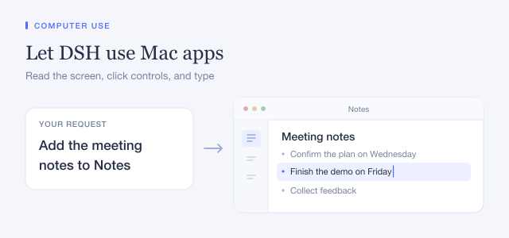

Windows npm installations require a separate helper. On x64, extract the entire standalone ZIP and set the provider’s `helperPath` to the absolute path of `dsh-cua-windows.exe`. On ARM64, use a helper built for that architecture.

