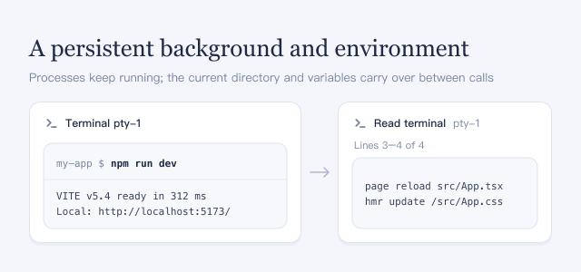

This plugin lets the agent open terminals in the sidebar beside the conversation. Each one is a real shell that you can watch: processes keep running between tool calls, and the current directory, exported variables and shell functions carry over. The agent can start a dev server, a file watcher, a debugger or a REPL, keep working while it runs, and come back later to read new output or type more input. The agent can also read terminals you opened yourself, for example when you ask about an error you just saw.

## How to use

- Ask for work that keeps running, for example "start the dev server in a terminal and check its output after the edit".
- The terminal opens as a sidebar tab with an **Agent** badge, expanding the sidebar if it is collapsed. Each step also appears in the conversation as a tool call.
- To take a terminal over, type or paste into it. The **Agent** badge disappears, and from then on the agent can only read that terminal; it opens a new one for further commands.
- Ask the agent to look at a terminal you opened, such as "check the error in my terminal". It reads the screen and never types into your own terminals.

## Good to know

- An agent terminal starts in the session's current folder under the session's access mode; hover its badge to see the mode. Commands you type in it run under the same access mode, and after you take over, a restricted terminal keeps a **Sandbox** badge; open your own terminal for unrestricted commands. Changing the access mode later leaves open terminals as they are.
- When a command asks for a password or a one-time code, type it yourself; the agent is told never to.
- Screen text the agent reads, including your own terminals, is added to the conversation and sent to the model. To stop the agent reading your terminals, set `readUserTerminals: false` on the `optional-terminal-panel` row in your profile patch.
- Only the main conversation's agent opens terminals; subagents cannot.
- Terminals stop when DSH restarts or this plugin is turned off. Keep results that must last in files.
- Turning this plugin on or off changes the tools of open sessions. Their next request cannot reuse the prompt cache, so it is slower and costs more once.
