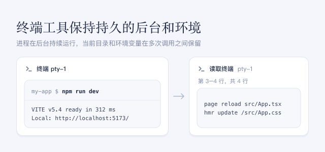

此插件让智能体在对话旁的侧栏中打开终端。每个终端都是你能看到的真实 shell：进程在多次工具调用之间持续运行，当前目录、导出的环境变量和 shell 函数也会保留。智能体可以启动开发服务器、文件监视程序、调试器或 REPL，在它运行期间继续工作，稍后再回来读取新输出或继续输入。智能体还可以读取你自己打开的终端，例如你问起刚看到的报错时。

## 使用方法

- 提出需要持续运行的工作，例如“在终端里启动开发服务器，改完代码后检查它的输出”。
- 终端会以带 **Agent** 徽标的侧栏标签页打开，侧栏折叠时会自动展开。每一步也会以工具调用的形式显示在对话中。
- 想接管终端时，直接在其中键入或粘贴。**Agent** 徽标随即消失，此后智能体只能读取这个终端，需要再执行命令时会另开一个终端。
- 让智能体查看你打开的终端，例如“看看我终端里的报错”。它只读取屏幕，从不在你自己的终端中输入。

## 注意事项

- 智能体的终端在会话的当前文件夹中启动，并按会话的访问模式运行；鼠标悬停在徽标上可看到该模式。你在其中键入的命令同样受这一访问模式约束，接管后受限的终端会保留 **沙箱** 徽标；需要不受限的命令时请自己新开终端。之后切换访问模式不会影响已经打开的终端。
- 命令要求输入密码或一次性验证码时，请你自己输入；智能体被要求绝不代为输入。
- 智能体读取的屏幕文本（包括你自己的终端）会加入对话并发送给模型。若不想让智能体读取你的终端，可在 profile patch 中把 `optional-terminal-panel` 行的 `readUserTerminals` 设为 `false`。
- 只有主对话的智能体可以打开终端，子智能体不能。
- DSH 重启或关闭此插件时，终端会停止。需要保留的结果请写入文件。
- 开启或关闭此插件会改变已打开会话的工具。这些会话的下一次请求无法复用提示词缓存，因此这一次会更慢、费用更高。
