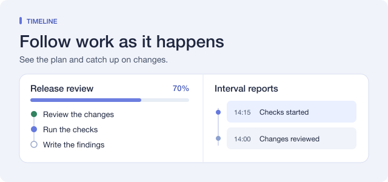

# Timeline

English | [中文](README.zh.md)

## Summary

Timeline shows what an agent is working on and what it has finished. Its task tree and progress bar follow the current session. Timed reports give you a record of changes you can review later.

## Table of Contents

- [Use this package](#use-this-package)
- [Understand the implementation](#understand-the-implementation)
- [Further Exploration](#further-exploration)
- [Model Experience](#model-experience)
- [Known Limitations and Deferred Work](#known-limitations-and-deferred-work)

-----

## Use this package

Open **Plugins → More → Timeline** and turn it on. Timeline is experimental and off by default. During a task with several steps, select **Open task tree** in the progress strip above the message box.

### Replace Todo and track progress

The sidebar opens when the first task tree appears in a session and the window is wider than 768 px. Turn off **Auto-open sidebar** under **Task tracking** to open it from the progress bar when you need it.

**Replace Todo tools (recommended)** is on by default when Timeline is enabled. The agent breaks work into tasks and subtasks and keeps the plan across turns. Open a task to read its description, results, blockers, and change history. When the main agent delegates work, subagents report progress and blockers to it. The main agent records their results in the shared tree.

Timeline calculates progress from the completed steps and weights recorded in the tree. Weights compare tasks under the same parent, including top-level tasks. For example, a completed task with weight 3 and an unstarted task with weight 1 give the group 75% progress. Subtasks divide their parent's share of the work. Splitting existing work into more subtasks leaves that share unchanged. The segmented bar shows how much work is completed, in progress, pending, or blocked. You can set the number of decimal places and turn the segments on or off.

Expand a progress card in the conversation to see recent task changes, their notes, and the progress before and after the update. Use the card to open the task tree.

If the agent goes 24 iterations in a turn without a successful task update, Timeline reminds it to record progress. Change this threshold under **Task update reminder**.

### Read reports at several intervals

During active work, Timeline generates timed reports in the background. The default minimum intervals are 15 minutes, 1 hour, and 4 hours. Each higher level combines saved reports from the level below it. If a report becomes due while the session is idle, Timeline checks for it when work resumes. The first report without tool calls starts with an active turn and waits for a full interval.

In the sidebar, open **Timeline** and select the **Reports** tab to browse the reports. Select a column heading to focus its interval, or select it again to compare all columns at equal widths. Open a report to read its details and the intervals it includes. If the current window is empty, select **Jump to last report** to open the latest saved period. Set the intervals in the plugin detail page. Each level must be longer than the previous one and at most seven days. Turn off **Generate timed reports** to pause new reports and keep the saved reports available.

### Discuss and direct work

Open a task or report to ask a question or give feedback in **Discussion**. Switching views keeps the draft in the current session view. The saved discussion and the agent’s reply stay with that item. Set a task’s priority to help the agent choose what to work on next. You can also ask the agent to pause or continue a task or a whole tree.

### Move a task tree

Use **Fork session** to continue work in a separate session. The fork keeps the task trees, saved progress, and discussions at the selected point. It starts a new report history. Pending pause and continue requests stay in the source session.

Use **Task tree actions → Export task tree** to download a `.timeline.json` file. The same menu lets you import a saved tree or delete a tree and its discussions from the session. The file keeps task progress, weights, priorities, change history, and task tree discussions. Timed reports stay with the session where they were generated.

Type `/timeline` in the message box to open the sidebar and see command help. To import a checkpoint, wait until the session is idle, then type `/timeline @plan.timeline.json`. Quote paths with spaces, as in `/timeline @"My plan.timeline.json"`.

Importing the same checkpoint again selects the existing tree. Add `--copy` to create another tree. Add `--continue` to request continuation after the import saves. To pause or continue work on a tree you already have open, use the controls in the task or tree view.

The file has a format version separate from the plugin version. Export a tree from the standalone plugin before switching to this edition, then import the file here. Disable the standalone plugin before enabling this edition.

### Set languages and writing guidance

The interface follows the Harness display language. **Follow app** uses the display language set in Harness. If the display language is automatic, Timeline uses the connected browser’s language for new task text and reports. Without a browser language, it uses the Host language. Timeline supports English, Simplified Chinese, Japanese, Spanish, French, German, Russian, and Brazilian Portuguese.

Edit **Task writing guidance** for task titles and details, **Instructions for all levels** for all reports, and the additional instructions for each report level. The defaults ask the agent to lead with concrete results, explain unfamiliar terms and numbers, and connect findings to your goal. You can restore the default guidance in the editor.

-----

## Understand the implementation

Maintainer details

Timeline writes task and report changes to the Session log. The Session projection restores the plan, reports, and discussions when you reopen it. The agent that owns the plan records updates from delegated workers. The report scheduler adapts ideas from [dsh-progress-check](https://github.com/kermanx/dsh-progress-check), under the MIT license.

The [Connection service](../../client/connection/README.md#browser-authentication-and-request-trust) mounts the Timeline RPC channel when the Web server is available. Timeline accepts edits and browser language updates from an authenticated owner.

-----

## Further Exploration

[Manage optional plugins](../../client/ui-plugin-manager/README.md#use-this-package)

[Timeline changelog](docs/CHANGELOG.md)

-----

## Model Experience

### Task tracking and reports

#### What the model sees

The agent uses `timeline_tree` and `timeline_tasks` to plan and update work. It uses `timeline_pull` to find unfinished work, `timeline_read` to inspect the plan, and `timeline_reply` to answer a discussion. Timeline supplies the current plan, reminders after missed updates, and notices when a task enters or leaves P0 or when you delete a task tree. If **Replace Todo tools** is on, Timeline takes the place of Todo. Workers report their results to the agent that owns the plan.

#### Token effect

Task planning uses the conversation’s normal model calls. Timed reports can use separate calls to the session’s selected provider and model. These calls use additional tokens.

#### KV Cache effect

Enabling Timeline adds tools and planning guidance to subsequent requests. The first report level reuses the latest eligible request prefix. Higher levels send the saved reports they summarize. If a draft fails validation, Timeline can send one separate repair request. The Session log stores the report request and references any reused prefix by sequence.

## Known Limitations and Deferred Work

- The timeline shows up to seven days of reports at a time and up to 512 discussions. The Session log retains report history outside the visible range.
- A task update writes the current tree to the Session log, up to 2 MiB per write. Revisions keep the description and progress at each edit and show a short preview when details change.
- Pause and continue controls ask the agent to update the plan at a safe checkpoint. Use Harness Stop to stop an active turn.

### Dev Note

The projection stores up to 50,400 reports across all levels. Each report event scans the retained list to replace duplicate IDs and enforce retention. When the list loses entries, the projection checks any report discussions against the retained IDs. With N reports inside the window, full replay can scan O(N²) entries. An observed report change sends the complete Timeline view through the Session projection.
