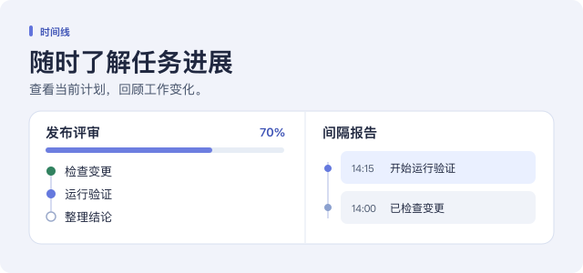

# 时间线

[English](README.md) | 中文

## 概述

时间线显示智能体正在处理和已经完成的工作。任务树和进度条随当前会话更新。定时报告记录工作变化，方便稍后查看。

## 目录

- [使用此包](#use-this-package)
- [了解实现](#understand-the-implementation)
- [进一步了解](#further-exploration)
- [模型体验](#model-experience)
- [已知限制与待办工作](#known-limitations-and-deferred-work)

-----

## 使用此包

打开**插件 → 更多 → 时间线**并启用。时间线是实验性插件，默认关闭。处理多步骤任务时，可在消息输入框上方的进度栏中点击**打开任务树**。

### 替代 Todo 并跟踪进度

窗口宽度超过 768 像素时，会话中出现第一棵任务树会自动打开侧栏。可在**任务跟踪**中关闭**自动打开侧栏**，需要时从进度栏手动打开。

启用时间线后，**替代待办清单（推荐）**默认开启。智能体将工作拆分为任务和子任务，计划可跨轮次保留。打开任务可查看说明、结果、阻塞原因和更改记录。主智能体委派任务后，子智能体向它汇报进展和阻塞事项，由主智能体把结果记录在共享任务树中。

时间线按任务树中记录的完成步数和权重计算进度。权重用于比较同一父任务下的工作，顶层任务也按此规则比较。例如，一项权重为 3 的任务已完成，另一项权重为 1 的任务尚未开始，该组的进度为 75%。子任务分配父任务的工作占比。将已有工作拆成更多子任务，父任务的占比保持不变。分段进度条显示已完成、进行中、待开始和已阻塞的工作占比。可设置进度小数位数，也可关闭或开启分段显示。

在对话中展开进展卡片，可查看最近更新的任务、任务记录和更新前后的进度，也可从卡片打开任务树。

如果智能体在同一轮次内连续 24 次迭代没有成功更新任务，时间线会提醒它记录进展。可在**提醒智能体更新进度**中修改此间隔。

### 查看分层报告

工作进行时，时间线在后台生成定时报告。各层级的默认最短间隔为 15 分钟、1 小时和 4 小时。上层报告汇总下一层已保存的报告。若报告在会话空闲时到期，时间线会在恢复工作时检查是否需要生成报告。首份没有工具调用的报告从活跃轮次开始计时，等待一个完整间隔后生成。

在侧栏中打开**时间线**，点击**报告**页签浏览报告。点击列标题可聚焦该层级，再次点击可等宽对比各列。打开报告可查看详情和所含时段。当前范围没有报告时，可选择**跳转到最后一份报告**，查看最近保存的时段。在插件详情页可修改各层级的间隔。每层的间隔必须比上一层长，且最多为七天。关闭**生成定时报告**可暂停生成新报告，已保存的报告仍可查看。

### 讨论并调整工作

打开任务或报告，可在**讨论**中提问或反馈。在当前会话视图内切换页面时，讨论草稿会保留。已保存的讨论和智能体的答复会保存在对应条目中。可调整任务优先级，帮助智能体选择下一项工作。也可请智能体暂停或继续单项任务或整棵树。

### 迁移任务树

选择**分叉会话**，可在单独的会话中继续工作。分支保留分叉点的任务树、已保存的进度和讨论，并独立记录报告。尚未确认的暂停或继续请求留在源会话中。

选择**任务树操作 → 导出任务树**，下载 `.timeline.json` 文件。也可在同一菜单中导入已保存的任务树，或从会话中删除任务树及其讨论。文件保留任务进度、权重、优先级、更改记录和任务树讨论。定时报告保留在生成报告的会话中。

在消息框中输入 `/timeline`，可打开侧栏并查看命令用法。导入前，等待会话空闲，再输入 `/timeline @plan.timeline.json`。路径含空格时，用引号括起路径，例如 `/timeline @"My plan.timeline.json"`。

再次导入同一个文件会选中已有任务树。添加 `--copy` 可创建另一棵任务树。添加 `--continue` 会在导入保存后请求智能体继续工作。要暂停或继续当前任务树中的工作，请使用任务详情或任务树中的控件。

导出文件的格式版本独立于插件版本。切换到此版本前，从独立版导出任务树，再在此处导入文件。启用此版本前，请先停用独立版插件。

### 设置语言和写作指引

界面跟随 Harness 的显示语言。选择**跟随应用**后，新任务文本和报告使用在 Harness 中设置的显示语言。如果显示语言设为自动，新任务文本和报告使用已连接浏览器的语言。若未收到浏览器语言，则使用 Host 的语言。时间线支持英语、简体中文、日语、西班牙语、法语、德语、俄语和巴西葡萄牙语。

可编辑**任务编写提示词**来调整任务标题和详情，也可修改适用于所有报告的**所有层级的报告要求**，或为各层级添加提示词。默认指引要求智能体先写具体结果，解释生僻术语和数字，并说明发现与用户目标的关系。可在编辑器中恢复默认指引。

-----

## 了解实现

维护者说明

时间线将任务和报告的变更写入会话日志。重新打开会话时，会话投影恢复计划、报告和讨论。拥有计划的智能体负责记录子智能体汇报的进展。报告调度参考了采用 MIT 许可证的 [dsh-progress-check](https://github.com/kermanx/dsh-progress-check)。

Web 服务器可用时，[连接服务](../../client/connection/README.zh.md#browser-authentication-and-request-trust)会挂载时间线的 RPC 通道。时间线只接受已通过认证的所有者提交的编辑和浏览器语言更新。

-----

## 进一步了解

[管理可选插件](../../client/ui-plugin-manager/README.zh.md#use-this-package)

[时间线更新记录](docs/CHANGELOG.md)

-----

## 模型体验

### 任务跟踪与报告

#### 模型收到的内容

智能体使用 `timeline_tree` 和 `timeline_tasks` 规划和更新工作，使用 `timeline_pull` 查找未完成工作，使用 `timeline_read` 查看计划，使用 `timeline_reply` 回复讨论。时间线提供当前计划、更新提醒，以及任务进入或退出 P0、用户删除任务树时的通知。开启**替代待办清单（推荐）**后，时间线取代待办工具。子智能体向拥有计划的智能体汇报结果。

#### Token 影响

任务规划使用对话中的常规模型调用。定时报告可使用会话选定的服务商和模型单独发起调用。这些调用会消耗额外的 Token。

#### KV Cache 影响

启用时间线会为后续请求添加工具和计划指引。首层报告复用最近一次符合条件的请求前缀。更高层发送需要汇总的已保存报告。草稿未通过校验时，时间线可以另发一次修正请求。会话日志保存报告请求，并通过序号引用复用的前缀。

## 已知限制与待办工作

- 时间线一次最多显示七天的报告和 512 条讨论。会话日志保留显示范围之外的报告。
- 每次任务更新会向会话日志写入当前任务树，单次写入最多 2 MiB。修订记录保留每次编辑的描述和进度，并在详情变化时显示简短预览。
- 暂停和继续按钮会请智能体在安全节点更新计划。要停止正在运行的回合，请使用 Harness 的停止按钮。

### 开发备注

会话投影最多保留所有层级合计 50,400 条报告。每次记录报告时，投影扫描保留列表，替换 ID 重复的报告并执行保留规则。列表移除条目时，投影根据保留的 ID 检查报告讨论。窗口内有 N 条报告时，完整回放最多扫描 O(N²) 个条目。客户端订阅报告变化时，会话投影发送完整的时间线视图。
