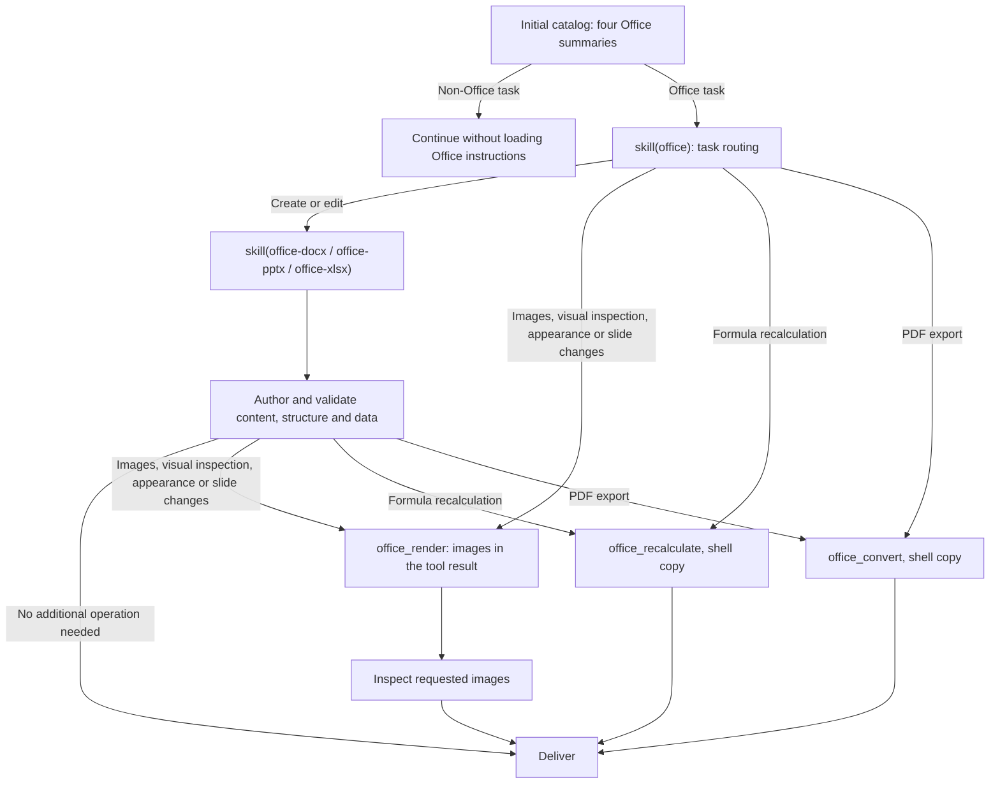

# @deepseek-ai/dsh-skill-office

English | [中文](README.zh.md)

## Summary

The catalog lists the Office router and three authoring skills. Full instructions load on demand. The authoring skills append the configured Python environment; the skills direct operations to [`office_render`, `office_convert`, and `office_recalculate`](../../document/tool-office/README.md), with shell copies of output files. Desktop and an SDK with a primary runtime mount the provider; the bundled dependency query mounts beside it whenever a primary runtime is available.

## Table of Contents

- [Use this package](#use-this-package)
  - [Progressive loading](#progressive-loading)
- [Understand the implementation](#understand-the-implementation)
- [Further Exploration](#further-exploration)
- [Model Experience](#model-experience)
- [Known Limitations and Deferred Work](#known-limitations-and-deferred-work)
- [Dev Note](#dev-note)

-----

<a id="use-this-package"></a>
## Use this package

Mount the skill provider beside the skill registry and `dsh-tool-skill`. The provider supplies skill instructions; Python skills append a Python environment section. The skills direct operations to `office_render`, `office_convert`, and `office_recalculate`, so compose [`tool-office`](../../document/tool-office/README.md) beside this provider.

```yaml
- name: '@deepseek-ai/dsh-skill-office'

```

| Field | Default | Meaning |
|---|---|---|
| `assetRoot` | Carrier resources or packaged `assets/` | Absolute directory containing the four skill folders. |
| `pythonEnvironment` | `'workspace-dependencies'` | Python that `office-docx`, `office-pptx`, and `office-xlsx` direct the model to; see below. |

`pythonEnvironment` selects one fixed section appended to those three skills. Both values first defer to an explicit user or applicable AGENTS.md environment requirement. `'workspace-dependencies'` directs the model to call `load_workspace_dependencies` and use the bundled Python and libraries it returns; mount it only with `dsh-tool-workspace-dependencies`. A custom composition that mounts this package without `dsh-tool-workspace-dependencies` must configure `pythonEnvironment: user`. `'user'` directs the model to the project's or user's existing Python on PATH, to check that the required libraries import, and to name missing packages instead of installing them globally without the user's agreement.

A relative `assetRoot` rejects registration. Catalog discovery reads each `SKILL.md`. A missing or invalid skill is omitted from the catalog with a warning, and a skill whose file disappears after discovery fails to load and leaves the catalog. Other read errors, such as a locked file, leave discovery incomplete so the registry retries it. Loading instructions resolves no executable and prepares no engine; the Office tools report an unavailable LibreOffice Kit when called. Bash or PowerShell owns the approvals, sandboxing, and cancellation of copying converted files into the workspace.

<a id="progressive-loading"></a>
### Progressive loading

The model chooses skills from the task; the host does not inject complete instructions based on file extensions. With complete resources, all four skills are listed and loadable by name through `skill` or explicit user invocation. Loading an Office skill makes the three Office tools available from the next step; when they are not in the tool list, such as after a PTC resume or fork, the skills direct the model to load `office` again. Legacy `.doc`, `.xls`, and `.ppt` files, which python-docx, openpyxl, and python-pptx cannot read, are converted with `office_convert` before editing. Requested appearance changes, including spreadsheet cell fills and text alignment, require rendering even without an explicit visual-check request, and so do new or changed slide content in presentations; an explicit request to skip rendering takes precedence. Standalone operations use the dedicated tools after routing without loading an authoring skill. PDF export alone stops after checking that the copied output is nonempty and starts with `%PDF-`.



Documents and workbooks render only for requested images, visual inspection, or appearance changes, because their libraries verify content and Word reflows text. Presentations also render new or changed slide content, because python-pptx cannot measure text fit in fixed-size boxes; speaker-notes edits do not render. Preview images arrive in the `office_render` result, so no workspace files are created for inspection; replies report the inspection in text. Converted and recalculated files arrive as temporary paths that the model copies into the workspace with `cp` or `Copy-Item`. Loaded instructions remain in session history after an operation finishes. The diagram describes ordinary presets across supported clients; it does not change the shell-only definition of minimal or sdk-minimal.

Ordinary Word text edits inspect the target runs and formatting, then reopen the saved document to verify the edit. Successful checks end validation; package and metadata investigation requires a concrete problem or an explicit request.

-----

<a id="understand-the-implementation"></a>
## Understand the implementation

<details>
<summary>Implementation internals — click to expand</summary>

The provider reads descriptions during catalog discovery and bodies on demand. Registry precedence, scope, and invocation permissions apply to every skill. Each loaded skill includes its resource directory for relative references. Disposal unregisters all candidates.

The provider registers no tools or activation projection. Loaded skill results remain logged through the generic skill loader. In PTC programs, print or return the full `tools.skill(...)` result so its instructions reach the model. Resume and fork use existing session history and tool declaration reconciliation. Loading a skill resolves no executable.

| File | Responsibility |
|---|---|
| [`src/index.ts`](src/index.ts) | Provider registration, per-skill resource reads, and the appended Python environment section. |

| [`assets/`](assets/) | Router and three authoring skills. |

</details>

-----

<a id="further-exploration"></a>
## Further Exploration

- [Skill registry](../skill/README.md) — discovery and precedence.
- [Skill tool](../tool-skill/README.md) — model catalogs and loaded bodies.
- [File delivery](../../deliverables/tool-present/README.md) — current source-path delivery.
- [Office tools](../../document/tool-office/README.md) — rendering, conversion, and recalculation.

-----

<a id="model-experience"></a>
## Model Experience

Indirectly, through `dsh-tool-skill`, which renders the initial Office summary and returns routing or selected subskill instructions from `skill(name)`. The Python skills end with a Python environment section that names either `load_workspace_dependencies` or the user's existing Python, according to `pythonEnvironment`.

#### KV Cache effect

Skill results append to history, and loaded text or images remain after an operation finishes. With `tool-office` mounted, the first successful Office skill load enables the three tool declarations on the next step. A skill omitted or removed for unreadable resources changes the catalog, which a later step publishes as a catalog update. Character estimates use `ceil(characters / 4)`: the summary is at most 50 tokens and the router body at most 200; each authoring body is at most 70% of its recorded earlier estimate: 1,688 tokens for `office-docx`, 1,879 for `office-pptx`, and 2,330 for `office-xlsx`. The appended Python environment section stays fixed while the configuration stays unchanged, and counts toward each skill body. Skill wrappers, the generic catalog, shell and Office tool declarations, and `load_workspace_dependencies` are separate costs, and these estimates are not server usage.

## Known Limitations and Deferred Work

<a id="known-limitations-and-deferred-work"></a>

- The provider does not install authoring libraries.
- LibreOffice output can differ from native Office applications.
- Legacy, encrypted, and macro-enabled files need an appropriate separate workflow.
- An omitted skill is reported only through `ctx.logger`; no product UI tells the user that installed resources are missing (tracking issue #7677).
- The `office` router body names every subskill, so it still points to a subskill omitted for missing resources; the `skill` tool reports that subskill as unavailable.
- A skill whose file is missing or whose metadata is invalid counts as a persistent failure, so the skill catalog is cached without it; restoring the file does not list the skill until the application restarts or the plugin reloads.

<a id="dev-note"></a>
### Dev Note

<details>
<summary>Working context for maintainers — click to expand</summary>

None.

</details>
