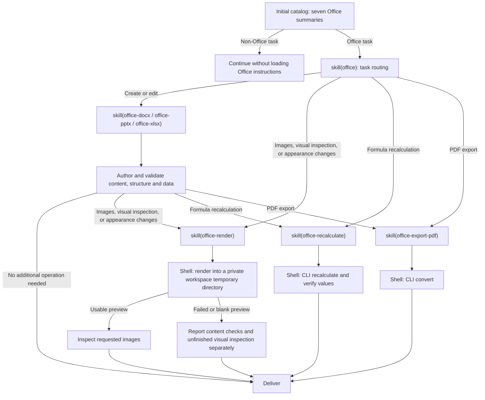

# @deepseek-ai/dsh-skill-office

English | [中文](README.zh.md)

## Summary

The catalog lists the Office router and six authoring or operation skills. Full instructions load on demand. Python authoring and verification skills append the configured Python environment; operation skills supply the configured Node and LibreOffice Kit CLI paths. The Web application and SDK profiles mount the provider; only Desktop, or an SDK with a primary runtime, also mounts the bundled dependency query.

## Table of Contents

- [Use this package](#use-this-package)
  - [Progressive loading](#progressive-loading)
- [Understand the implementation](#understand-the-implementation)
- [Further Exploration](#further-exploration)
- [Model Experience](#model-experience)
- [Known Limitations and Deferred Work](#known-limitations-and-deferred-work)
- [Dev Note](#dev-note)

-----

<a id="use-this-package"></a>
## Use this package

Mount the skill provider beside the skill registry and `dsh-tool-skill`. The provider supplies skill instructions; Python skills append a Python environment section, and operation skills append absolute interpreter and CLI paths when loaded.

```yaml
- name: '@deepseek-ai/dsh-skill-office'

```

| Field | Default | Meaning |
|---|---|---|
| `assetRoot` | Carrier resources or packaged `assets/` | Absolute directory containing the seven skill folders. |
| `node` | Host Node.js | Standalone Node executable for operation skills; packaged carriers supply it explicitly. |
| `cli` | CLI of this package's Kit | Absolute CLI entry; `false` disables operation execution. |
| `kitRoot` | Unrestricted | Absolute root for automatic Kit entry and CLI discovery after realpath and ASAR-unpacked mapping; explicit `cli` bypasses it. |
| `pythonEnvironment` | `'workspace-dependencies'` | Python that `office-docx`, `office-pptx`, `office-xlsx`, and `office-recalculate` direct the model to; see below. |

`pythonEnvironment` selects one fixed section appended to those four skills. Both values first defer to an explicit user or applicable AGENTS.md environment requirement. `'workspace-dependencies'` directs the model to call `load_workspace_dependencies` and use the bundled Python and libraries it returns; mount it only with `dsh-tool-workspace-dependencies`. A custom composition that mounts this package without `dsh-tool-workspace-dependencies` must configure `pythonEnvironment: user`. `'user'` directs the model to the project's or user's existing Python on PATH, to check that the required libraries import, and to name missing packages instead of installing them globally without the user's agreement.

A relative `assetRoot` or `kitRoot` rejects registration. Catalog discovery reads each `SKILL.md`. A missing or invalid skill is omitted from the catalog with a warning, and a skill whose file disappears after discovery fails to load and leaves the catalog. Other read errors, such as a locked file, leave discovery incomplete so the registry retries it. Authoring instructions do not resolve renderer paths; loading operation instructions validates existing interpreter and CLI files without preparing engines. The [`/locate` entry of Office Kit](../../document/office-kit/README.md#locate-kit) selects these files. When `cli` is omitted and this package cannot resolve Kit within `kitRoot` when configured, operation skills state that LibreOffice Kit is not available in this deployment, and the plugin reports each distinct lookup failure once through `ctx.logger.warn`; a configured `node` or `cli` that is not an absolute existing file, or an omitted `node` in Electron, fails the skill load. Bash or PowerShell owns approvals, sandboxing, cancellation, and output management. Resources and execution tools must refer to the same host.

<a id="progressive-loading"></a>
### Progressive loading

The model chooses skills from the task; the host does not inject complete instructions based on file extensions. With complete resources, all seven skills are listed and loadable by name through `skill` or explicit user invocation. Requested appearance changes, including spreadsheet cell fills and text alignment, require rendering even without an explicit visual-check request; an explicit request to skip rendering takes precedence. Pure operations can enter the corresponding skill directly.



New files and content, data, or formula edits do not require rendering solely because they include incidental basic formatting. Preview images use a private, randomly named temporary directory inside the workspace and are removed after inspection; replies report the inspection in text without linking them. PDF export validates the command result and `%PDF-` signature without searching for PDF readers. Loaded instructions remain in session history after an operation finishes. The diagram describes ordinary presets across supported clients; it does not change the shell-only definition of minimal or sdk-minimal.

Ordinary Word text edits inspect the target runs and formatting, then reopen the saved document to verify the edit. Successful checks end validation; package and metadata investigation requires a concrete problem or an explicit request.

-----

<a id="understand-the-implementation"></a>
## Understand the implementation

<details>
<summary>Implementation internals — click to expand</summary>

The provider reads descriptions during catalog discovery and bodies on demand. Registry precedence, scope, and invocation permissions apply to every skill. Each loaded skill includes its resource directory for relative references. Disposal unregisters all candidates.

The provider registers no tools or activation projection. Loaded skill results remain logged through the generic skill loader. In PTC programs, print or return the full `tools.skill(...)` result so its instructions reach the model. Resume and fork use existing session history and tool declaration reconciliation. Interpreter and CLI paths are resolved only when an operation skill is loaded.

| File | Responsibility |
|---|---|
| [`src/index.ts`](src/index.ts) | Provider registration, per-skill resource reads, and appended Python environment and Kit sections. |

| [`assets/`](assets/) | Router and six subskills. |

</details>

-----

<a id="further-exploration"></a>
## Further Exploration

- [Skill registry](../skill/README.md) — discovery and precedence.
- [Skill tool](../tool-skill/README.md) — model catalogs and loaded bodies.
- [File delivery](../../deliverables/tool-present/README.md) — current source-path delivery.

-----

<a id="model-experience"></a>
## Model Experience

Indirectly, through `dsh-tool-skill`, which renders the initial Office summary and returns routing or selected subskill instructions from `skill(name)`. The Python skills end with a Python environment section that names either `load_workspace_dependencies` or the user's existing Python, according to `pythonEnvironment`.

#### KV Cache effect

Skill results append to history without changing tool declarations, and loaded text or images remain after an operation finishes. A skill omitted or removed for unreadable resources changes the catalog, which a later step publishes as a catalog update. Character estimates use `ceil(characters / 4)`: the summary is at most 50 tokens and the router body at most 200; authoring bodies are at least 35% smaller than the combined authoring and operation guides. The appended Python environment section and the operation skills' Kit section stay fixed while the configuration and installed resources stay unchanged, and count toward each skill body. Skill wrappers, the generic catalog, shell declarations, and `load_workspace_dependencies` are separate costs, and these estimates are not server usage.

## Known Limitations and Deferred Work

<a id="known-limitations-and-deferred-work"></a>

- The provider does not install authoring libraries.
- LibreOffice output can differ from native Office applications.
- Legacy, encrypted, and macro-enabled files need an appropriate separate workflow.
- An omitted skill is reported only through `ctx.logger`; no product UI tells the user that installed resources are missing.
- The `office` router body names every subskill, so it still points to a subskill omitted for missing resources; the `skill` tool reports that subskill as unavailable.

<a id="dev-note"></a>
### Dev Note

<details>
<summary>Working context for maintainers — click to expand</summary>

None.

</details>
