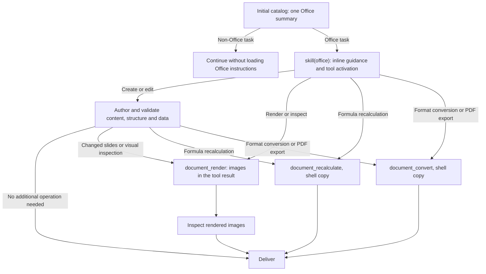

# @deepseek-ai/dsh-skill-office

English | [中文](README.zh.md)

## Summary

The catalog lists one `office` skill. Its instructions load on demand, cover Word, PowerPoint, and Excel pitfalls alongside [`document_render`, `document_convert`, and `document_recalculate`](../../document/tool-document/README.md), and end with the configured Python environment. The Web application and SDK profiles mount the provider; only Desktop, or an SDK with a primary runtime, also mounts the bundled dependency query.

## Table of Contents

- [Use this package](#use-this-package)
  - [Progressive loading](#progressive-loading)
- [Understand the implementation](#understand-the-implementation)
- [Further Exploration](#further-exploration)
- [Model Experience](#model-experience)
- [Known Limitations and Deferred Work](#known-limitations-and-deferred-work)
- [Dev Note](#dev-note)

-----

<a id="use-this-package"></a>
## Use this package

Mount the skill provider beside the skill registry and `dsh-tool-skill`. The provider supplies the `office` instructions and appends a Python environment section. The instructions direct operations to `document_render`, `document_convert`, and `document_recalculate`, so compose [`tool-document`](../../document/tool-document/README.md) beside this provider.

```yaml
- name: '@deepseek-ai/dsh-skill-office'

```

| Field | Default | Meaning |
|---|---|---|
| `assetRoot` | Packaged `assets/` | Absolute directory containing the `office` skill folder with `SKILL.md`. |
| `pythonEnvironment` | `'workspace-dependencies'` | Python that the `office` skill directs the model to; see below. |

`pythonEnvironment` selects one fixed section appended to the `office` skill. Both values first defer to an explicit user or applicable AGENTS.md environment requirement. `'workspace-dependencies'` directs the model to call `load_workspace_dependencies` and use the bundled Python and libraries it returns; mount it only with `dsh-tool-workspace-dependencies`. A custom composition that mounts this package without `dsh-tool-workspace-dependencies` must configure `pythonEnvironment: user`. `'user'` directs the model to the project's or user's existing Python on PATH, to check that the required libraries import, and to name missing packages instead of installing them globally without the user's agreement.

A relative `assetRoot` rejects registration. Catalog discovery and loading read `office/SKILL.md`. A missing or invalid skill file omits the skill from the catalog with a warning that names the path, and a file that disappears after discovery fails the load and removes the skill from the catalog. Other read errors, such as a locked file, leave discovery incomplete so the registry retries it. Loading instructions resolves no executable and prepares no engine; the Office tools report an unavailable LibreOffice Kit when called. Bash or PowerShell owns the approvals, sandboxing, and cancellation of copying converted files into the workspace.

<a id="progressive-loading"></a>
### Progressive loading

The model chooses skills from the task; the host does not inject complete instructions based on file extensions. With complete resources, the `office` skill is listed and loadable through `skill` or explicit user invocation as `/office`. Loading `office` delivers concise inline guidance for Word, PowerPoint, and Excel pitfalls, names `pypdf` in the bundled Python for existing PDFs, and makes the three Office tools available from the next step; when they are not in the tool list, such as after a PTC resume or fork, the instructions direct the model to load `office` again. Legacy `.doc`, `.xls`, and `.ppt` files, which python-docx, openpyxl, and python-pptx cannot open, are converted with `document_convert` first.



The inline instructions state the silent data-loss pitfalls across formats: Word text edits change text inside runs because assigning `paragraph.text` drops run formatting, and CJK text needs a `w:eastAsia` font alongside `run.font.name`; PowerPoint edits render changed slides because python-pptx cannot measure whether text fits its box; Excel edits use `document_recalculate` when formula results must show because openpyxl writes formulas without calculated values, and avoid writing a pandas DataFrame over an existing workbook because that drops other sheets, formulas, and formatting; and the original file is kept unless the user asks to replace it. Preview images arrive in the `document_render` result, and converted and recalculated files arrive as temporary paths that the model copies into the workspace with `cp` or `Copy-Item`. Loaded instructions remain in session history after an operation finishes. The diagram describes ordinary presets across supported clients; it does not change the shell-only definition of minimal or sdk-minimal.

-----

<a id="understand-the-implementation"></a>
## Understand the implementation

<details>
<summary>Implementation internals — click to expand</summary>

The provider reads the description during catalog discovery and the body on demand. Registry precedence, scope, and invocation permissions apply to the skill, so a higher-precedence skill named `office` replaces the bundled instructions. The loaded skill includes its resource directory for relative references. Disposal unregisters the candidate.

The provider registers no tools or activation projection. Loaded skill results remain logged through the generic skill loader. In PTC programs, print or return the full `tools.skill(...)` result so its instructions reach the model. Resume and fork use existing session history and tool declaration reconciliation. Loading a skill resolves no executable.

| File | Responsibility |
|---|---|
| [`src/index.ts`](src/index.ts) | Provider registration, `SKILL.md` reads, and the appended Python environment section. |

| [`assets/office/`](assets/office/) | `SKILL.md` inline Office guidance and tool activation instructions. |

</details>

-----

<a id="further-exploration"></a>
## Further Exploration

- [Skill registry](../skill/README.md) — discovery and precedence.
- [Skill tool](../tool-skill/README.md) — model catalogs and loaded bodies.
- [File delivery](../../deliverables/tool-present/README.md) — current source-path delivery.
- [Office tools](../../document/tool-document/README.md) — rendering, conversion, and recalculation.

-----

<a id="model-experience"></a>
## Model Experience

Indirectly, through `dsh-tool-skill`, which renders the one-line `office` summary in the catalog and returns the complete instructions from `skill(office)`. The instructions end with a Python environment section that names either `load_workspace_dependencies` or the user's existing Python, according to `pythonEnvironment`.

#### KV Cache effect

Skill results append to history, and loaded text or images remain after an operation finishes. With `tool-document` mounted, the first successful `office` load enables the three tool declarations on the next step. A skill omitted or removed for an unreadable skill file changes the catalog, which a later step publishes as a catalog update. Character estimates use `ceil(characters / 4)`: the summary is at most 50 tokens, the body without the Python environment section is 235 tokens, and the complete `office` body with the Python environment section is at most 350 tokens (346 for `'workspace-dependencies'` and 348 for `'user'`). The appended Python environment section stays fixed while the configuration stays unchanged, and counts toward the `office` body. Skill wrappers, the generic catalog, shell and Office tool declarations, and `load_workspace_dependencies` are separate costs, and these estimates are not server usage.

## Known Limitations and Deferred Work

<a id="known-limitations-and-deferred-work"></a>

- The provider does not install authoring libraries.
- LibreOffice output can differ from native Office applications.
- Legacy, encrypted, and macro-enabled files need an appropriate separate workflow.
- An omitted skill is reported only through `ctx.logger`; no product UI tells the user that installed resources are missing (tracking issue #7677).
- A skill whose `SKILL.md` is missing or whose metadata is invalid counts as a persistent failure, so the skill catalog is cached without it; restoring the file does not list the skill until the application restarts or the plugin reloads.

<a id="dev-note"></a>
### Dev Note

<details>
<summary>Working context for maintainers — click to expand</summary>

None.

</details>
