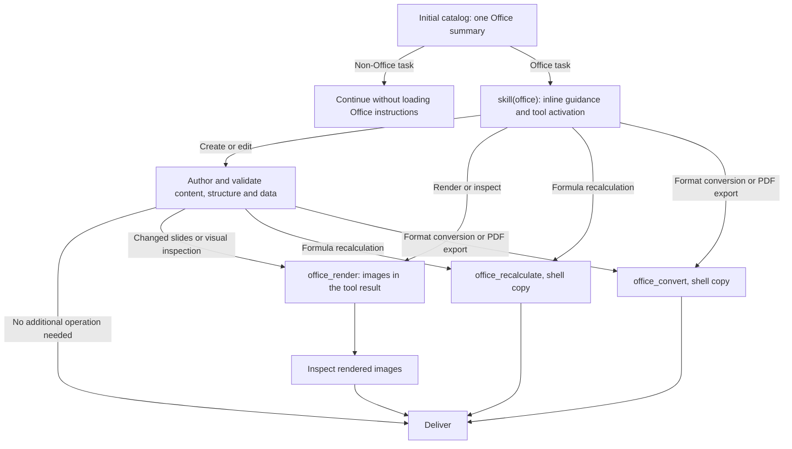

# @deepseek-ai/dsh-skill-office

[English](README.md) | 中文

## 概述

目录只列出一个 `office` 技能。其说明按需加载，内联涵盖 Word、PowerPoint 和 Excel 的易错点以及 [`office_render`、`office_convert` 和 `office_recalculate`](../../document/tool-office/README.zh.md)，并在末尾附上配置的 Python 环境说明。Web 应用和 SDK profile 挂载该提供者；只有 Desktop 或带主运行时的 SDK 还挂载内置依赖查询。

## 目录

- [使用本包](#use-this-package)
  - [渐进加载](#progressive-loading)
- [理解实现](#understand-the-implementation)
- [进一步探索](#further-exploration)
- [模型体验](#model-experience)
- [已知限制与后续工作](#known-limitations-and-deferred-work)
- [开发备注](#dev-note)

-----

<a id="use-this-package"></a>
## 使用本包

在技能注册表和 `dsh-tool-skill` 旁挂载技能提供者。提供者负责 `office` 说明，并追加 Python 环境说明。说明把操作交给 `office_render`、`office_convert` 和 `office_recalculate`，因此需在本提供者旁组合 [`tool-office`](../../document/tool-office/README.zh.md)。

```yaml
- name: '@deepseek-ai/dsh-skill-office'

```

| 字段 | 默认值 | 含义 |
|---|---|---|
| `assetRoot` | 包内 `assets/` | 包含 `office` 技能目录（内有 `SKILL.md`）的绝对路径。 |
| `pythonEnvironment` | `'workspace-dependencies'` | `office` 技能指引模型使用的 Python；见下文。 |

`pythonEnvironment` 选择追加到 `office` 技能末尾的一段固定说明。两个取值都先遵守用户或适用 AGENTS.md 明确要求的环境。`'workspace-dependencies'` 指引模型调用 `load_workspace_dependencies`，使用其返回的内置 Python 与库；仅在同时挂载 `dsh-tool-workspace-dependencies` 时使用。只挂载本包而不挂载 `dsh-tool-workspace-dependencies` 的自定义组合必须配置 `pythonEnvironment: user`。`'user'` 指引模型使用项目或用户已有的 PATH 上的 Python，先检查所需库能否 import，缺少时说明需要安装的包，未经用户同意不向全局环境安装。

相对路径的 `assetRoot` 会阻止注册。目录发现和加载时读取 `office/SKILL.md`。技能文件缺失或无效时，该技能从目录中省略，并记录给出该路径的警告；发现之后文件消失时，加载失败，技能从目录中移除。其他读取错误（例如文件被锁）会使本次发现不完整，由注册表重试。加载说明时不解析任何可执行文件，也不准备引擎；调用 Office 工具时才会报告 LibreOffice Kit 不可用。把转换后的文件复制进工作区时，由 Bash 或 PowerShell 负责审批、沙箱和取消。

<a id="progressive-loading"></a>
### 渐进加载

模型依据任务选择技能；宿主不会根据文件扩展名注入完整说明。资源完整时，`office` 技能列入目录，可通过 `skill` 加载或由用户以 `/office` 显式调用。加载 `office` 会返回 Word、PowerPoint 和 Excel 易错点的精简内联说明，指出内置 Python 提供 `pypdf` 用于读取现有 PDF，并使三个 Office 工具从下一步开始可用；工具不在列表中时（例如 PTC 模式 resume 或 fork 之后），说明会指示模型重新加载 `office`。python-docx、openpyxl 和 python-pptx 无法打开的旧格式 `.doc`、`.xls`、`.ppt` 文件，先用 `office_convert` 转换。



内联说明列出了各格式容易导致静默数据丢失的要点：Word 文本编辑在 run 内部修改文字，因为直接给 `paragraph.text` 赋值会丢弃段落内 run 的格式，且中日韩文字除设置 `run.font.name` 外还需设置 `w:eastAsia` 字体；PowerPoint 编辑后渲染修改过的幻灯片，因为 python-pptx 无法测量文字是否超出文本框；Excel 编辑在需要显示公式结果时调用 `office_recalculate`，因为 openpyxl 写入公式时不计算结果，且不要将 pandas DataFrame 直接覆盖写入已有工作簿，否则会丢失其他工作表、公式和格式；除非用户要求覆盖，否则保留原文件。预览图片直接出现在 `office_render` 结果中，转换和重算的文件以临时路径返回，由模型用 `cp` 或 `Copy-Item` 复制进工作区。操作结束后，已加载的说明仍属于会话历史。图中描述各端常规预设，不改变 minimal 或 sdk-minimal 的纯 shell 定义。

-----

<a id="understand-the-implementation"></a>
## 理解实现

<details>
<summary>实现细节 — 点击展开</summary>

提供者在目录发现时读取摘要，按需读取正文。注册表优先级、作用域和调用权限适用于该技能，因此优先级更高的同名 `office` 技能会替换内置说明。加载结果包含用于解析相对引用的资源目录。卸载提供者会移除该候选技能。

提供者不注册工具或激活投影。通用技能加载器记录已加载技能的结果。PTC 程序需输出或返回完整的 `tools.skill(...)` 结果，使说明进入模型上下文。恢复和 fork 使用现有会话历史及工具声明更新机制。加载技能时不解析任何可执行文件。

| 文件 | 职责 |
|---|---|
| [`src/index.ts`](src/index.ts) | 注册提供者、读取 `SKILL.md`，并追加 Python 环境说明。 |

| [`assets/office/`](assets/office/) | `SKILL.md` 内联 Office 说明与工具激活指引。 |

</details>

-----

<a id="further-exploration"></a>
## 进一步探索

- [技能注册表](../skill/README.zh.md) — 发现和优先级。
- [技能工具](../tool-skill/README.zh.md) — 模型目录和加载正文。
- [文件交付](../../deliverables/tool-present/README.zh.md) — 当前源文件路径交付。
- [Office 工具](../../document/tool-office/README.zh.md) — 渲染、转换和重算。

-----

<a id="model-experience"></a>
## 模型体验

间接影响：`dsh-tool-skill` 在目录中渲染一行 `office` 摘要，并通过 `skill(office)` 返回完整说明。说明末尾的 Python 环境部分按 `pythonEnvironment` 指向 `load_workspace_dependencies` 或用户已有的 Python。

#### KV Cache 影响

技能结果追加到历史中，操作完成后已加载文本或图片仍保留在历史中。挂载 `tool-office` 时，首次成功加载 `office` 会在下一步启用三个工具声明。因技能文件不可读而省略或移除的技能会改变目录，后续步骤会将其作为目录更新发布。字符估算采用 `ceil(字符数 / 4)`：摘要最多 50 token，不含 Python 环境说明的正文为 232 token，含 Python 环境说明的完整 `office` 正文最多 350 token（`'workspace-dependencies'` 为 344 token，`'user'` 为 346 token）。配置不变时，追加的 Python 环境说明保持不变，并计入 `office` 正文。技能包装、通用目录、shell 与 Office 工具声明和 `load_workspace_dependencies` 单独计费；这些估算不等同于服务端 usage。

## 已知限制与后续工作

<a id="known-limitations-and-deferred-work"></a>

- 提供者不安装创作库。
- LibreOffice 输出可能不同于原生 Office 应用。
- 旧格式、加密和启用宏的文件需要适用的独立工作流。
- 被省略的技能只通过 `ctx.logger` 报告；产品界面不会提示用户已安装资源缺失（跟踪 issue #7677）。
- `SKILL.md` 缺失或元数据无效的技能被判为持久失败，技能目录会在不含它的状态下被缓存；补回文件后，需要重启应用或重新加载插件，该技能才会出现。

<a id="dev-note"></a>
### 开发备注

<details>
<summary>维护者工作上下文 — 点击展开</summary>

无。

</details>
