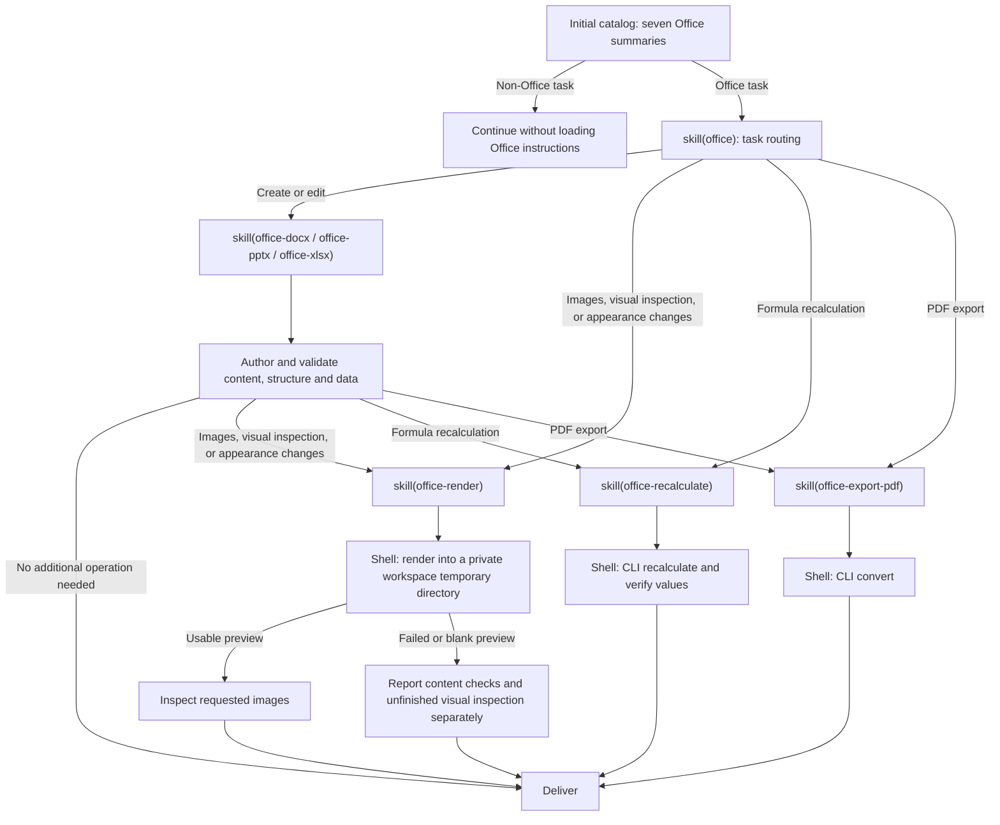

# @deepseek-ai/dsh-skill-office

[English](README.md) | 中文

## 概述

目录列出 Office 路由及六个创作或操作技能，完整说明按需加载。Python 创作与校验技能追加配置的 Python 环境说明；操作技能提供配置的 Node 与 LibreOffice Kit CLI 路径。Web 应用和 SDK profile 挂载该提供者；只有 Desktop 或带主运行时的 SDK 还挂载内置依赖查询。

## 目录

- [使用本包](#use-this-package)
  - [渐进加载](#progressive-loading)
- [理解实现](#understand-the-implementation)
- [进一步探索](#further-exploration)
- [模型体验](#model-experience)
- [已知限制与后续工作](#known-limitations-and-deferred-work)
- [开发备注](#dev-note)

-----

<a id="use-this-package"></a>
## 使用本包

在技能注册表和 `dsh-tool-skill` 旁挂载技能提供者。提供者负责技能说明；加载时，Python 技能追加 Python 环境说明，操作技能附加解释器和 CLI 的绝对路径。

```yaml
- name: '@deepseek-ai/dsh-skill-office'

```

| 字段 | 默认值 | 含义 |
|---|---|---|
| `assetRoot` | 载体资源或包内 `assets/` | 包含七个技能目录的绝对路径。 |
| `node` | 宿主 Node.js | 操作技能使用的独立 Node 可执行程序；打包载体显式提供。 |
| `cli` | 本包所用 Kit 的 CLI | CLI 入口的绝对路径；`false` 禁用操作执行。 |
| `kitRoot` | 不限制 | 自动查找的 Kit 入口和 CLI 在 realpath 与 ASAR 解包映射后必须位于此绝对根目录内；显式 `cli` 不受限制。 |
| `pythonEnvironment` | `'workspace-dependencies'` | `office-docx`、`office-pptx`、`office-xlsx` 和 `office-recalculate` 指引模型使用的 Python；见下文。 |

`pythonEnvironment` 选择追加到这四个技能末尾的一段固定说明。两个取值都先遵守用户或适用 AGENTS.md 明确要求的环境。`'workspace-dependencies'` 指引模型调用 `load_workspace_dependencies`，使用其返回的内置 Python 与库；仅在同时挂载 `dsh-tool-workspace-dependencies` 时使用。只挂载本包而不挂载 `dsh-tool-workspace-dependencies` 的自定义组合必须配置 `pythonEnvironment: user`。`'user'` 指引模型使用项目或用户已有的 PATH 上的 Python，先检查所需库能否 import，缺少时说明需要安装的包，未经用户同意不向全局环境安装。

相对路径的 `assetRoot` 或 `kitRoot` 会阻止注册。目录发现时读取每个 `SKILL.md`。缺失或无效的技能会从目录中省略并记录警告；发现之后文件消失的技能加载失败，并从目录中移除。其他读取错误（例如文件被锁）会使本次发现不完整，由注册表重试。创作说明不解析渲染器路径；操作说明加载时校验现有解释器和 CLI 文件，不准备引擎。这些文件由 [Office Kit 的 `/locate` 入口](../../document/office-kit/README.zh.md#locate-kit)选定。未配置 `cli` 且本包无法在配置的 `kitRoot` 范围内解析 Kit 时，操作技能说明本部署没有可用的 LibreOffice Kit，插件通过 `ctx.logger.warn` 对每种不同的查找失败只报告一次；配置的 `node` 或 `cli` 不是存在的绝对路径文件，或在 Electron 中未配置 `node` 时，技能加载失败。Bash 或 PowerShell 负责审批、沙箱、取消和输出管理。资源与执行工具必须位于同一主机。

<a id="progressive-loading"></a>
### 渐进加载

模型依据任务选择技能；宿主不会根据文件扩展名注入完整说明。资源完整时，七个技能均列入目录，可通过 `skill` 按名称加载或由用户显式调用。用户要求的外观修改，包括电子表格单元格填充和文本对齐，即使没有明确要求视觉检查，也需要渲染；用户明确要求跳过渲染时以该要求为准。纯操作任务可以直接进入对应技能。



新建文件以及内容、数据或公式修改，不会仅因附带基础格式调整而需要渲染。预览图片保存在工作区内随机命名的私有临时目录中，并在检查后删除；回复以文字说明检查结果，不链接这些图片。PDF 导出校验命令结果和 `%PDF-` 签名，不另外查找 PDF 阅读工具。操作结束后，已加载的说明仍属于会话历史。图中描述各端常规预设，不改变 minimal 或 sdk-minimal 的纯 shell 定义。

普通 Word 文本编辑只检查目标文本片段及其格式，保存后重新打开文档验证修改。检查通过即结束验证；只有遇到具体问题或明确要求时才探查内部包结构和元数据。

-----

<a id="understand-the-implementation"></a>
## 理解实现

<details>
<summary>实现细节 — 点击展开</summary>

提供者在目录发现时读取摘要，按需读取正文。注册表优先级、作用域和调用权限适用于全部技能。加载结果包含用于解析相对引用的资源目录。卸载提供者会移除全部候选技能。

提供者不注册工具或激活投影。通用技能加载器记录已加载技能的结果。PTC 程序需输出或返回完整的 `tools.skill(...)` 结果，使说明进入模型上下文。恢复和 fork 使用现有会话历史及工具声明更新机制。解释器和 CLI 路径仅在加载操作技能时解析。

| 文件 | 职责 |
|---|---|
| [`src/index.ts`](src/index.ts) | 注册提供者、逐个读取技能资源，并追加 Python 环境与 Kit 说明。 |

| [`assets/`](assets/) | 路由与六个子技能。 |

</details>

-----

<a id="further-exploration"></a>
## 进一步探索

- [技能注册表](../skill/README.zh.md) — 发现和优先级。
- [技能工具](../tool-skill/README.zh.md) — 模型目录和加载正文。
- [文件交付](../../deliverables/tool-present/README.zh.md) — 当前源文件路径交付。

-----

<a id="model-experience"></a>
## 模型体验

间接影响：`dsh-tool-skill` 渲染初始 Office 摘要，并返回 `skill(name)` 选择的路由或子技能说明。Python 技能末尾的 Python 环境说明按 `pythonEnvironment` 指向 `load_workspace_dependencies` 或用户已有的 Python。

#### KV Cache 影响

技能结果追加到历史中且不改变工具声明，操作完成后已加载文本或图片仍保留在历史中。因资源不可读而省略或移除的技能会改变目录，后续步骤会将其作为目录更新发布。字符估算采用 `ceil(字符数 / 4)`：摘要最多 50 token，路由正文最多 200 token；创作正文比合并后的创作与操作指南至少减少 35%。配置和已安装资源不变时，追加的 Python 环境说明和操作技能的 Kit 说明保持不变，并计入各技能正文。技能包装、通用目录、shell 声明和 `load_workspace_dependencies` 单独计费；这些估算不等同于服务端 usage。

## 已知限制与后续工作

<a id="known-limitations-and-deferred-work"></a>

- 提供者不安装创作库。
- LibreOffice 输出可能不同于原生 Office 应用。
- 旧格式、加密和启用宏的文件需要适用的独立工作流。
- 被省略的技能只通过 `ctx.logger` 报告；产品界面不会提示用户已安装资源缺失。
- `office` 路由正文列出全部子技能，因此仍会指向因资源缺失而被省略的子技能；`skill` 工具会报告该子技能不可用。

<a id="dev-note"></a>
### 开发备注

<details>
<summary>维护者工作上下文 — 点击展开</summary>

无。

</details>
