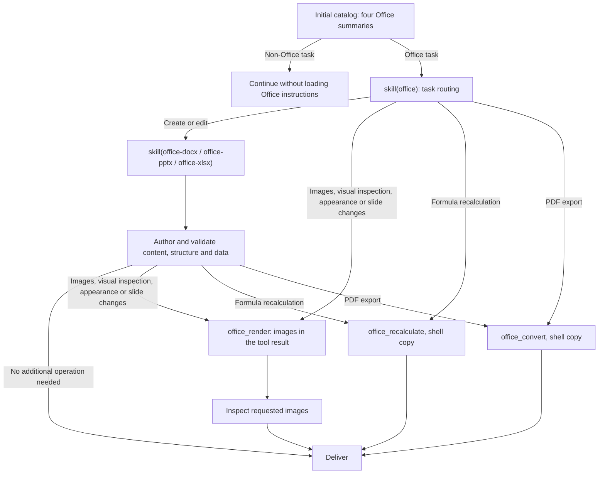

# @deepseek-ai/dsh-skill-office

[English](README.md) | 中文

## 概述

目录列出 Office 路由及三个创作技能，完整说明按需加载。创作技能追加配置的 Python 环境说明；技能把操作交给 [`office_render`、`office_convert` 和 `office_recalculate`](../../document/tool-office/README.zh.md)，并用 shell 复制输出文件。Desktop 和带主运行时的 SDK 挂载该提供者；有主运行时时，内置依赖查询也挂载在它旁边。

## 目录

- [使用本包](#use-this-package)
  - [渐进加载](#progressive-loading)
- [理解实现](#understand-the-implementation)
- [进一步探索](#further-exploration)
- [模型体验](#model-experience)
- [已知限制与后续工作](#known-limitations-and-deferred-work)
- [开发备注](#dev-note)

-----

<a id="use-this-package"></a>
## 使用本包

在技能注册表和 `dsh-tool-skill` 旁挂载技能提供者。提供者负责技能说明；加载时，Python 技能追加 Python 环境说明。技能把操作交给 `office_render`、`office_convert` 和 `office_recalculate`，因此需在本提供者旁组合 [`tool-office`](../../document/tool-office/README.zh.md)。

```yaml
- name: '@deepseek-ai/dsh-skill-office'

```

| 字段 | 默认值 | 含义 |
|---|---|---|
| `assetRoot` | 载体资源或包内 `assets/` | 包含四个技能目录的绝对路径。 |
| `pythonEnvironment` | `'workspace-dependencies'` | `office-docx`、`office-pptx` 和 `office-xlsx` 指引模型使用的 Python；见下文。 |

`pythonEnvironment` 选择追加到这三个技能末尾的一段固定说明。两个取值都先遵守用户或适用 AGENTS.md 明确要求的环境。`'workspace-dependencies'` 指引模型调用 `load_workspace_dependencies`，使用其返回的内置 Python 与库；仅在同时挂载 `dsh-tool-workspace-dependencies` 时使用。只挂载本包而不挂载 `dsh-tool-workspace-dependencies` 的自定义组合必须配置 `pythonEnvironment: user`。`'user'` 指引模型使用项目或用户已有的 PATH 上的 Python，先检查所需库能否 import，缺少时说明需要安装的包，未经用户同意不向全局环境安装。

相对路径的 `assetRoot` 会阻止注册。目录发现时读取每个 `SKILL.md`。缺失或无效的技能会从目录中省略并记录警告；发现之后文件消失的技能加载失败，并从目录中移除。其他读取错误（例如文件被锁）会使本次发现不完整，由注册表重试。加载说明时不解析任何可执行文件，也不准备引擎；调用 Office 工具时才会报告 LibreOffice Kit 不可用。把转换后的文件复制进工作区时，由 Bash 或 PowerShell 负责审批、沙箱和取消。

<a id="progressive-loading"></a>
### 渐进加载

模型依据任务选择技能；宿主不会根据文件扩展名注入完整说明。资源完整时，四个技能均列入目录，可通过 `skill` 按名称加载或由用户显式调用。加载 Office 技能后，三个 Office 工具从下一步开始可用；工具不在列表中时（例如 PTC 模式 resume 或 fork 之后），技能会指示模型重新加载 `office`。python-docx、openpyxl 和 python-pptx 无法读取的旧格式 `.doc`、`.xls`、`.ppt` 文件，先用 `office_convert` 转换再编辑。用户要求的外观修改，包括电子表格单元格填充和文本对齐，即使没有明确要求视觉检查，也需要渲染，演示文稿中新增或修改的幻灯片内容同样需要渲染；用户明确要求跳过渲染时以该要求为准。单独的操作任务在路由后直接调用专用工具，不加载创作技能。单独的 PDF 导出在检查复制出的文件非空且以 `%PDF-` 开头后即结束。



文档和工作簿只在要求图片、视觉检查或外观修改时渲染，因为相应的库能验证内容，而 Word 会重新排版文字。演示文稿还会渲染新增或修改的幻灯片内容，因为 python-pptx 无法测量固定大小文本框中的文字是否放得下；只修改演讲者备注时不渲染。预览图片直接出现在 `office_render` 结果中，检查不会在工作区创建文件；回复以文字说明检查结果。转换和重算的文件以临时路径返回，由模型用 `cp` 或 `Copy-Item` 复制进工作区。操作结束后，已加载的说明仍属于会话历史。图中描述各端常规预设，不改变 minimal 或 sdk-minimal 的纯 shell 定义。

普通 Word 文本编辑只检查目标文本片段及其格式，保存后重新打开文档验证修改。检查通过即结束验证；只有遇到具体问题或明确要求时才探查内部包结构和元数据。

-----

<a id="understand-the-implementation"></a>
## 理解实现

<details>
<summary>实现细节 — 点击展开</summary>

提供者在目录发现时读取摘要，按需读取正文。注册表优先级、作用域和调用权限适用于全部技能。加载结果包含用于解析相对引用的资源目录。卸载提供者会移除全部候选技能。

提供者不注册工具或激活投影。通用技能加载器记录已加载技能的结果。PTC 程序需输出或返回完整的 `tools.skill(...)` 结果，使说明进入模型上下文。恢复和 fork 使用现有会话历史及工具声明更新机制。加载技能时不解析任何可执行文件。

| 文件 | 职责 |
|---|---|
| [`src/index.ts`](src/index.ts) | 注册提供者、逐个读取技能资源，并追加 Python 环境说明。 |

| [`assets/`](assets/) | 路由与三个创作技能。 |

</details>

-----

<a id="further-exploration"></a>
## 进一步探索

- [技能注册表](../skill/README.zh.md) — 发现和优先级。
- [技能工具](../tool-skill/README.zh.md) — 模型目录和加载正文。
- [文件交付](../../deliverables/tool-present/README.zh.md) — 当前源文件路径交付。
- [Office 工具](../../document/tool-office/README.zh.md) — 渲染、转换和重算。

-----

<a id="model-experience"></a>
## 模型体验

间接影响：`dsh-tool-skill` 渲染初始 Office 摘要，并返回 `skill(name)` 选择的路由或子技能说明。Python 技能末尾的 Python 环境说明按 `pythonEnvironment` 指向 `load_workspace_dependencies` 或用户已有的 Python。

#### KV Cache 影响

技能结果追加到历史中，操作完成后已加载文本或图片仍保留在历史中。挂载 `tool-office` 时，首次成功加载 Office 技能会在下一步启用三个工具声明。因资源不可读而省略或移除的技能会改变目录，后续步骤会将其作为目录更新发布。字符估算采用 `ceil(字符数 / 4)`：摘要最多 50 token，路由正文最多 200 token；每个创作正文最多为其记录的早期估算的 70%：`office-docx` 为 1,688 token，`office-pptx` 为 1,879 token，`office-xlsx` 为 2,330 token。配置不变时，追加的 Python 环境说明保持不变，并计入各技能正文。技能包装、通用目录、shell 与 Office 工具声明和 `load_workspace_dependencies` 单独计费；这些估算不等同于服务端 usage。

## 已知限制与后续工作

<a id="known-limitations-and-deferred-work"></a>

- 提供者不安装创作库。
- LibreOffice 输出可能不同于原生 Office 应用。
- 旧格式、加密和启用宏的文件需要适用的独立工作流。
- 被省略的技能只通过 `ctx.logger` 报告；产品界面不会提示用户已安装资源缺失（跟踪 issue #7677）。
- `office` 路由正文列出全部子技能，因此仍会指向因资源缺失而被省略的子技能；`skill` 工具会报告该子技能不可用。
- 文件缺失或元数据无效的技能被判为持久失败，技能目录会在不含它的状态下被缓存；补回文件后，需要重启应用或重新加载插件，该技能才会出现。

<a id="dev-note"></a>
### 开发备注

<details>
<summary>维护者工作上下文 — 点击展开</summary>

无。

</details>
